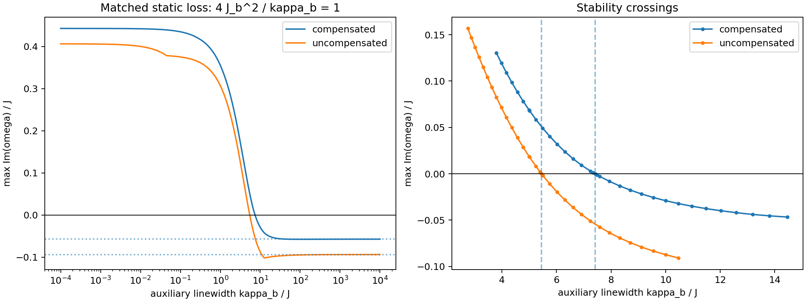
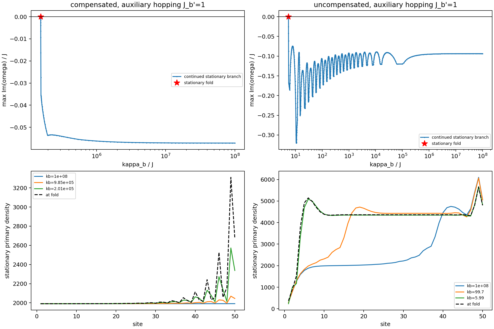

# Chiral Bose–Hubbard chain with local lossy auxiliary cavities

This document defines a replacement of the local Markovian loss of the V=0 chain by one auxiliary bosonic cavity b_j per primary site a_j. The primary chain is driven at epsilon=38.51. The combined a+b system has a Markovian Lindblad description; eliminating b produces a finite-memory environment for a. We derive the mean-field stationary equations and full Bogoliubov operator, without covariance feedback or a self-consistent Gaussian ansatz. The stability results for the matched N=50 comparison are included below.

The use of damped auxiliary modes to represent structured reservoirs is the pseudomode construction; see [Pleasance, Garraway and Petruccione, Phys. Rev. Research 2, 043058 (2020)](https://arxiv.org/abs/2002.09739). The specific equations and matching prescription below are derived for this project's Hamiltonian conventions.

## Parameters and conventions

Set hbar=1, with energies/rates in units of J and time in 1/J. Use sites j=1,...,N and OBC unless stated otherwise. Keep N symbolic; N=50 is the natural first comparison with the previous compensated calculations.

The primary-chain parameters are

$$
J=1,\qquad U=-2\times10^{-4},\qquad V=0,\qquad
\Delta_a=0.5,\qquad \phi=\pi/3,\qquad \epsilon=38.51.
$$

Each b_j has detuning Delta_b relative to the **same drive frequency** used for a_j, local coupling J_b>=0 and photon-number decay rate kappa_b>0. All auxiliary parameters are homogeneous initially. We leave Delta_b explicit and take Delta_b=0 as the default matched comparison: auxiliaries resonant with the drive, not necessarily with the bare primary cavity. A phase of the local a-b coupling can be removed by independent rephasings of the undriven, mutually uncoupled b modes.

There is no b-b hopping, no auxiliary drive or Kerr nonlinearity, and no intersite shared bath. The primary chain's original direct loss is **removed**. A residual direct loss kappa_a is included in the general formulas for clarity but set to zero in the replacement model. The old target loss kappa_target=1 is a matching parameter, not an additional loss channel.

## Hamiltonian and master equation

Write n_j=a_j^dagger a_j and m_j=b_j^dagger b_j. In the drive frame,

$$
\begin{aligned}
H={}&\sum_{j=1}^{N}\left[
\Delta_a n_j+U n_j^2+F_j a_j^\dagger+F_j^*a_j
+\Delta_b m_j+J_b(a_j^\dagger b_j+b_j^\dagger a_j)
\right]\\
&+J\sum_{j=1}^{N-1}\left(
e^{i\phi}a_{j+1}^\dagger a_j+
e^{-i\phi}a_j^\dagger a_{j+1}\right).
\end{aligned}
$$

The complex coherent pump is F_j=epsilon for the uncompensated chain; optional compensation adds endpoint fields to F_1 and F_N. Each hopping bond is counted once. In matrix notation T[j+1,j]=J exp(i phi), T[j,j+1]=J exp(-i phi). If PBC are used, include the directed closing bond (N,1) with the same phase and total twist N*phi modulo 2*pi.

The zero-temperature master equation is

$$
\dot\rho=-i[H,\rho]+
\kappa_b\sum_j\mathcal D[b_j]\rho+
\kappa_a\sum_j\mathcal D[a_j]\rho,
\qquad
\mathcal D[c]\rho=c\rho c^\dagger-\tfrac12\{c^\dagger c,\rho\}.
$$

Thus a free auxiliary **amplitude** decays at kappa_b/2. For the model requested here, kappa_a=0; retaining the old kappa=1 as well would instead describe an additional structured loss channel.

## Mean-field equations

Let alpha_j=<a_j> and beta_j=<b_j>. Retain the paper's onsite U*n_j^2 convention: n_j^2=a_j^{dagger 2}a_j^2+n_j. Factorization of normally ordered moments gives

$$
\boxed{
i\dot\alpha_j=F_j+\sum_k T_{jk}\alpha_k+
\left(\Delta_a+U+2U|\alpha_j|^2-i\kappa_a/2\right)\alpha_j
+J_b\beta_j,
}
$$
$$
\boxed{
i\dot\beta_j=(\Delta_b-i\kappa_b/2)\beta_j+J_b\alpha_j.
}
$$

Missing OBC neighbors are omitted. In the bulk the hopping term is J[exp(i phi)alpha_(j-1)+exp(-i phi)alpha_(j+1)]. The +U shift is not absorbed into Delta_a. These are 2N complex equations, with no fluctuation correction in the mean-field force. Vacuum initialization means alpha_j(0)=beta_j(0)=0; initialization at an existing stationary state must include its corresponding nonzero beta_j.

## Eliminating the auxiliaries: memory and frequency dependence

Define gamma_b=kappa_b/2. The auxiliary solution is

$$
\beta_j(t)=e^{-(\gamma_b+i\Delta_b)t}\beta_j(0)
-iJ_b\int_0^t ds\,e^{-(\gamma_b+i\Delta_b)(t-s)}\alpha_j(s).
$$

Writing f_a,j^(0)=F_j+sum_k T_jk alpha_k+(Delta_a+U+2U|alpha_j|^2-i*kappa_a/2)alpha_j, substitution gives

$$
\dot\alpha_j(t)=-if_{a,j}^{(0)}(t)
-J_b^2\int_0^t ds\,e^{-(\gamma_b+i\Delta_b)(t-s)}\alpha_j(s)
-iJ_b e^{-(\gamma_b+i\Delta_b)t}\beta_j(0).
$$

The causal memory kernel is K(t)=J_b^2 exp[-(gamma_b+i Delta_b)t] for t>=0, with decay time tau_b=2/kappa_b. Smaller kappa_b gives longer memory. The reduced a dynamics generally cannot be replaced by a constant loss rate for arbitrary frequencies. Finite memory does not by itself assert a particular information-backflow/non-divisibility criterion at every parameter value.

At the operator/Langevin level, eliminating b also produces the filtered auxiliary vacuum input and its initial operator contribution. It would be incorrect to keep this retarded damping while discarding its associated noise. For the present mean-field and deterministic BdG definitions we can work directly with a+b and avoid that elimination.

With time dependence exp(-i omega t), the particle self-energy is

$$
\Sigma_p(\omega)=\frac{J_b^2}{\omega-\Delta_b+i\kappa_b/2}.
$$

For real omega, the induced photon-loss function is

$$
\kappa_{\rm aux}(\omega)=-2\operatorname{Im}\Sigma_p(\omega)
=\frac{J_b^2\kappa_b}{(\omega-\Delta_b)^2+(\kappa_b/2)^2}.
$$

This is Lorentzian; its dispersive part is Re Sigma_p(omega). For dynamical eigenmodes omega is complex and one must use the analytic self-energy, not merely substitute a real-frequency loss function into the old BdG matrix.

## Exact stationary elimination and matching the old chain

At a stationary solution,

$$
\beta_j=-\frac{J_b}{\Delta_b-i\kappa_b/2}\alpha_j.
$$

Consequently the primary stationary equation is exactly

$$
0=F_j+\sum_kT_{jk}\alpha_k+
\left[\Delta_a+\delta\Delta+U+2U|\alpha_j|^2
-\frac{i}{2}(\kappa_a+\kappa_{\rm aux}(0))\right]\alpha_j,
$$
$$
\delta\Delta=-\frac{J_b^2\Delta_b}{\Delta_b^2+(\kappa_b/2)^2},
\qquad
\kappa_{\rm aux}(0)=\frac{J_b^2\kappa_b}{\Delta_b^2+(\kappa_b/2)^2}.
$$

This elimination is exact for stationary mean-field states for kappa_b>0, irrespective of whether the dynamics is in a short-memory regime. It does not imply that their dynamical stability agrees with that of a Markovian chain.

For the simplest comparison, choose Delta_b=0, kappa_a=0 and enforce

$$
\boxed{\frac{4J_b^2}{\kappa_b}=\kappa_{\rm target}=1,
\qquad J_b=\tfrac12\sqrt{\kappa_{\rm target}\kappa_b}.}
$$

Then deltaDelta=0 and the primary **stationary equations are identical to the original chain** at every kappa_b>0, for compensated or uncompensated pumps. Varying kappa_b along this matching curve changes memory without changing the static mean-field equation. By contrast, changing kappa_b at fixed J_b also changes the static loss and hence generally the stationary density.

The short-memory Markov limit is kappa_b -> infinity **with J_b^2/kappa_b fixed**, and with relevant primary frequencies slow relative to kappa_b. On resonance Sigma_p(omega) tends to -i*kappa_target/2 at fixed omega. Taking kappa_b -> infinity at fixed J_b would instead remove the induced loss. The opposite endpoint kappa_b=J_b=0 is singular and is not part of the matched family.

For nonzero Delta_b, a static match can instead be made by satisfying kappa_aux(0)=kappa_target-kappa_a and adjusting the bare Delta_a so Delta_a+deltaDelta=0.5. Without that adjustment, the auxiliary also changes the effective detuning.

## Homogeneous intermediate solution and optional boundary compensation

For uniform bulk amplitudes alpha_0, beta_0 and density n=|alpha_0|^2,

$$
\epsilon^2=n\left[
\left(\Delta_a+\delta\Delta+U+2J\cos\phi+2Un\right)^2
+\left(\frac{\kappa_a+\kappa_{\rm aux}(0)}{2}\right)^2\right].
$$

Under the resonant matching prescription, the original three-root equation is retained. At epsilon=38.51 its intermediate root is

$$
n_0\simeq1990.52082476,\qquad
\alpha_0\simeq-36.3675375605-25.8442070210i.
$$

The auxiliary amplitude is beta_0=-2i J_b alpha_0/kappa_b. Its density satisfies |beta_0|^2=(kappa_target/kappa_b)n_0, so kappa_b|beta_0|^2=kappa_target n_0. A long-memory matched reservoir therefore stores a larger auxiliary population, despite the same stationary primary density and outgoing auxiliary photon flux.

For OBC the homogeneous primary state is made exactly stationary by the same missing-neighbor compensation as before:

$$
F_1=\epsilon+h_L,\qquad F_N=\epsilon+h_R,
\qquad h_L=J e^{i\phi}\alpha_0,\qquad h_R=J e^{-i\phi}\alpha_0,
$$

with F_j=epsilon otherwise. Numerically h_L=4.1979710406-44.4173149110i and h_R=-40.5655086011+18.5731078900i. No extra auxiliary-edge compensation is needed because each a site has exactly one local b cavity. Compensation is optional; the definition of the reservoir replacement does not require it. Stability of this homogeneous target must be reassessed with the auxiliaries included.

## Full Bogoliubov problem

At any stationary (alpha,beta), including an inhomogeneous uncompensated state, define

$$
A=T+\operatorname{diag}(\Delta_a+U+4U|\alpha_j|^2-i\kappa_a/2),
\quad B=\operatorname{diag}(2U\alpha_j^2),
\quad C=(\Delta_b-i\kappa_b/2)I_N.
$$

For z=(delta alpha,delta beta,delta alpha^*,delta beta^*)^T,

$$
i\dot z=\mathcal L_{ab}z,\qquad
\boxed{
\mathcal L_{ab}=\begin{pmatrix}
A&J_b I&B&0\\
J_b I&C&0&0\\
-B^*&0&-A^*&-J_b I\\
0&0&-J_b I&-C^*
\end{pmatrix}.}
$$

This is a 4N-by-4N non-Hermitian matrix, hence 200-by-200 at N=50. Its modes evolve as exp(-i omega t); strict asymptotic linear stability requires max Im omega<0, while a positive value is instability. Numerically unresolved near-zero values must be distinguished from either conclusion. Particle–hole pairing is omega <-> -omega^*. All auxiliary-like modes must be included; the old 2N primary-chain eigenvalues alone do not decide stability.

An equivalent primary-only frequency-domain problem, in the reordered primary Nambu sector (delta alpha,delta alpha^*), is

$$
\left[\omega I_{2N}-\mathcal L_a^{(0)}-
\begin{pmatrix}\Sigma_p(\omega)I&0\\0&\Sigma_h(\omega)I\end{pmatrix}\right]z_a=0,
$$
$$
\mathcal L_a^{(0)}=\begin{pmatrix}A&B\\-B^*&-A^*\end{pmatrix},
\qquad
\Sigma_h(\omega)=\frac{J_b^2}{\omega+\Delta_b+i\kappa_b/2}.
$$

The superscript (0) means that the auxiliary-induced damping has not already been inserted in A; kappa_a alone is included there. This is a nonlinear eigenvalue equation in omega, valid away from the eliminated auxiliary poles. The full matrix is preferable for computing all eigenvalues without missing modes or introducing spurious pole roots. A zero-frequency effective loss cannot substitute for the frequency dependence when assessing stability.

## Consequences for static response and topology

Along the resonant static-matching curve, Sigma_p(0)=Sigma_h(0)=-i*kappa_target/2. Thus, at the **same primary stationary background**, the zero-frequency primary Schur complement is exactly the original Markovian primary BdG operator. This fixes its static susceptibility, but not its dynamical poles or stability. A static inverse also need not describe an attainable long-time response if the enlarged system is unstable.

For a homogeneous bulk, a real reference frequency omega_ref and kappa_b>0, the auxiliary Nambu block is invertible and independent of momentum. Block elimination factorizes det[omega_ref-L_ab(k)] into its momentum-independent auxiliary determinant and the determinant of the primary Schur complement. Therefore their point-gap determinant windings agree whenever the point gap is open. In particular, at omega_ref=0 the compensated intermediate background retains the original bulk winding -1 on the matched curve, even though its stability may change. This statement is analytical and does not demonstrate a stable phase for arbitrary memory time.

The smallest singular value of the **full** 4N matrix need not equal that of the primary Schur complement: the full input/output space also contains auxiliary fluctuations, and block elimination is not unitary. Any SVD-based amplification comparison must specify whether inputs/outputs are primary-only, auxiliary, or unrestricted, as well as its reference frequency. Nonzero-frequency topology can also change because the auxiliary self-energy is frequency dependent.

## First numerical comparison enabled by this model

The clean comparison is to retain N=50, epsilon=38.51 and the other primary parameters above, set Delta_b=kappa_a=0, and scan kappa_b>0 with J_b=sqrt(kappa_b)/2. Lift each previously computed primary stationary state to beta=-2i J_b alpha/kappa_b and check both mean-field residuals. Compare the full 4N stability spectra for the homogeneous compensated target and the uncompensated background separately. This isolates changes in dynamics from changes in the static primary profile. Vacuum or ramp evolution, if later requested, must evolve both alpha and beta; fixed initial auxiliary amplitudes are not interchangeable with a pre-equilibrated reservoir.

Related conventions: [original mean-field/Bogoliubov derivation](mean_field_bogoliubov.md). The matched N=50 stability calculation is documented below; no general phase diagram is claimed.

## Numerical stability results: matched auxiliary decay

#### Result

For N=50, epsilon=38.51, J=1, U=-0.0002, V=0, Delta_a=0.5 and phi=pi/3, replacing direct kappa=1 loss by resonant local auxiliaries can destabilize both previously stable stationary backgrounds. We use Delta_b=0, no direct primary loss, and J_b=sqrt(kappa_b)/2, so 4*J_b^2/kappa_b=1. All primary stationary profiles remain exactly the same as in the Markovian problem; only dynamics and auxiliary populations change.

The compensated homogeneous intermediate state is stable for kappa_b>7.41212493*J. The uncompensated stationary state previously reached from vacuum is stable for kappa_b>5.45219985*J. Equality is marginal, and smaller positive linewidths are unstable for these respective branches. These are local linear-stability statements about fixed stationary states, not results of evolving from vacuum in the new model.

| Background | Critical kappa_b/J | J_b/J at crossing | Critical memory time J*tau_b | Markovian growth/J |
|:---|---:|---:|---:|---:|

| compensated | 7.412124929 | 1.361260898 | 0.269828156 | -0.057126665 |

| uncompensated | 5.452199853 | 1.167497308 | 0.366824411 | -0.093608639 |

Here tau_b=2/kappa_b. Thus increasing memory from the Markovian limit first destabilizes the compensated state. For 5.4522<kappa_b/J<7.4121 the uncompensated branch remains stable while the compensated branch is unstable; below 5.4522 both tested branches are unstable. This does not exclude additional stable stationary branches or nonstationary attractors.

#### Numerical growth rates

Growth means max Im(omega) for i*dot(z)=L_ab*z. A negative value is asymptotic linear stability.

| kappa_b/J | J_b/J | Compensated growth/J | Uncompensated growth/J |
|---:|---:|---:|---:|

| 0.01 | 0.05 | 0.442103905 | 0.400221902 |

| 0.1 | 0.158114 | 0.434926849 | 0.375246600 |

| 1 | 0.5 | 0.355262493 | 0.307033643 |

| 2 | 0.707107 | 0.265126854 | 0.219278120 |

| 5 | 1.11803 | 0.068618266 | 0.018609674 |

| 10 | 1.58114 | -0.029061657 | -0.087347793 |

| 20 | 2.23607 | -0.052854963 | -0.098587074 |

| 100 | 5 | -0.057446259 | -0.094555991 |

| 1000 | 15.8114 | -0.057181350 | -0.093702359 |

The large-linewidth limit recovers the old Markovian growth rates. Convergence need not be monotonic: finite memory can slightly increase damping before longer memory causes instability. Decreasing kappa_b at fixed J_b would be a different comparison because it changes the stationary effective loss.

#### Exact spectral mapping and threshold

Let L_a^(0) denote the primary-chain 2N-by-2N BdG operator at the chosen background, with the direct loss removed. Its blocks retain the onsite U*n^2 convention, including +U. Let lambda=x+i*y be any eigenvalue of L_a^(0). Since the resonant auxiliary particle and hole blocks are both -i*gamma_b times the identity, and the squared primary–auxiliary Nambu coupling is J_b^2 times the identity, the enlarged characteristic polynomial factorizes into scalar quadratic factors:

$$
(\omega-\lambda)(\omega+i\gamma_b)-J_b^2=0,
\qquad \gamma_b=\kappa_b/2,\quad J_b^2=\kappa_{\rm target}\gamma_b/2.
$$

Each lambda therefore gives two eigenvalues

$$
\omega_\pm=\frac{\lambda-i\gamma_b
\pm\sqrt{(\lambda+i\gamma_b)^2+4J_b^2}}{2}.
$$

This relation accounts for all 4N modes, including the auxiliary-like modes. The original Markovian spectrum is simply lambda-i*kappa_target/2. Both backgrounds have max y<kappa_target/2 but include modes with y>0: removing instantaneous damping exposes their gain, which the finite-bandwidth auxiliary reservoir may fail to suppress.

For y<=0, coupling this scalar mode to a damped auxiliary does not generate an instability. For 0<y<h, h=kappa_target/2, the two roots are strictly damped precisely when

$$
\gamma_b>y+|x|\sqrt{\frac{y}{h-y}}.
$$

Thus the full-chain threshold is

$$
\boxed{\kappa_{b,c}=2\max_{\lambda:\,0<y<h}
\left[y+|x|\sqrt{\frac{y}{h-y}}\right].}
$$

For nonzero x, this follows by setting a marginal omega real: the imaginary part of the quadratic gives omega=gamma_b*x/(gamma_b-y), and the real part gives y[1+x^2/(gamma_b-y)^2]=h. Stability requires gamma_b>y, selecting the upper crossing. The x=0 limit gives gamma_b,c=y. The high-linewidth branch is stable, and each scalar pair has only this stability boundary on gamma_b>y. Hence the matched family has no hidden reentrant stable interval below the reported threshold for these fixed backgrounds.

The modes that set the thresholds are:

| Background | Triggering primary eigenvalue lambda/J | Marginal frequency magnitude / J |
|:---|:---|---:|

| compensated | 1.200687510 + 0.440456373 i | 1.362633088 |

| uncompensated | -1.312948639 + 0.380699205 i | 1.526062969 |

Particle–hole symmetry supplies the opposite-frequency partner. The loss of stability is oscillatory (a finite-frequency linear crossing), not a stationary root disappearing. A nonlinear limit cycle is a possible subsequent behavior, but it has not been demonstrated here. The triggering mode need not be the least-damped mode in the Markovian limit; its nonzero frequency and the frequency-dependent reservoir response matter.

#### Topology and stationary profiles

The compensated density remains n=1990.52082476 on every primary site. Its original endpoint compensation is held fixed, and beta_j=-i*sqrt(kappa_target/kappa_b)*alpha_j. The uncompensated primary profile is the previously computed vacuum attractor at epsilon=38.51, with no endpoint additions; it is inhomogeneous and already contains an extended nonzero frozen-winding segment. We are not comparing a trivial bulk with a topological bulk in this study.

At omega_ref=0, the matched primary Schur complement is exactly the original Markovian BdG operator for either profile. The homogeneous compensated bulk therefore retains its point-gap winding -1 along the entire matched family even after its dynamics becomes unstable. No point-gap closure at zero is required for this finite-frequency instability. **Preservation of zero-frequency topology and existence of a stationary profile do not guarantee dynamical stability.** The winding statement is a bulk statement for the homogeneous target; no quantized invariant is assigned to the inhomogeneous chain here.

#### Methods and checks

The logarithmic scan contains 401 base linewidth values from 1e-4*J to 1e4*J, plus representative points and values bracketing each threshold by 1%. The analytic threshold is checked with a Brent root of the growth function (absolute linewidth tolerance 1e-11*J). The quadratic is evaluated using the root product to avoid cancellation when auxiliary and primary time scales are widely separated. Nine representative points per background, including both sides of each crossing, are independently diagonalized as full 200-by-200 matrices and in real-quadrature coordinates.

The installed real nonsymmetric eigensolver returned spurious eigenpairs with large residuals for these 200-dimensional generators. Those results are rejected. The real-coordinate matrices are instead cast to complex without changing any entries and diagonalized with the complex eigensolver; every accepted eigenpair set is checked against the original matrix. This agrees with the independent quadratic spectral mapping. This numerical issue is not interpreted as a physical instability.

For compensated: maximum full-spectrum mapping distance 6.46e-10J; maximum growth disagreement between particle/hole and real coordinates 3.52e-11J; maximum full eigenpair residual 8.2e-13; primary/auxiliary stationary force residuals below 3.52e-14J.

For uncompensated: maximum full-spectrum mapping distance 4.15e-10J; maximum growth disagreement between particle/hole and real coordinates 8.39e-12J; maximum full eigenpair residual 1.56e-12; primary/auxiliary stationary force residuals below 2.27e-13J.

The sign classification away from crossings uses a descriptive 1e-7*J resolution; the 1% brackets are well outside this band. Leading-eigenvalue condition numbers and first-order roundoff indicators are saved. The reported digits describe this N=50 finite-dimensional mean-field/BdG model, not a thermodynamic boundary or an interval-arithmetic certificate. No time evolution, basin study or fluctuation/noise calculation is performed, and no covariance feeds back into the stationary background.

Model and analytical conventions: [auxiliary-cavity derivation](non_markovian_auxiliary_cavity_model.md). Reproduce with `python src/auxiliary_decay_stability.py`. Results: `data/generated/auxiliary_decay/stability.json`; figure: `figures/auxiliary_decay_stability.png`. Primary backgrounds are taken from the epsilon=38.51 entry in `data/generated/compensation_n50/intermediate_preparation_35_40.json`.

## Extension: auxiliary cavities coupled by J_b' of order J

We now add real reciprocal nearest-neighbor auxiliary hopping, denoted J_b', distinct from the local primary–auxiliary coupling J_b. The first representative choice is J_b'=1 in units J=1, with the same OBC on both chains and no auxiliary drives. All preceding numerical thresholds apply to **J_b'=0 only**; the following is the definition and analytical consequences of the coupled-auxiliary model, not a new numerical stability scan.

### Hamiltonian, equations and spatial memory

Add

$$
H_{bb}=J_b'\sum_{j=1}^{N-1}(b_{j+1}^\dagger b_j+b_j^\dagger b_{j+1}).
$$

The primary mean-field equation is unchanged in form. The auxiliary equation becomes

$$
i\dot\beta_j=(\Delta_b-i\kappa_b/2)\beta_j
+J_b'\sum_{k:\,|k-j|=1}\beta_k+J_b\alpha_j.
$$

Define the real symmetric OBC auxiliary hopping matrix T_b with (T_b)_(j+1,j)=(T_b)_(j,j+1)=J_b', H_b=Delta_b I+T_b and C_b=H_b-i*gamma_b I. Then i*dot(beta)=C_b beta+J_b alpha. Eliminating the auxiliaries gives

$$
\dot{\boldsymbol\alpha}(t)=-i\boldsymbol f_a^{(0)}(t)
-J_b^2\int_0^t ds\,e^{-(\gamma_b I+iH_b)(t-s)}\boldsymbol\alpha(s)
-iJ_b e^{-(\gamma_b I+iH_b)t}\boldsymbol\beta(0).
$$

The kernel is now a **matrix in site space**: a primary excitation can enter its auxiliary, propagate along the b chain, and return to a different primary site. The corresponding eliminated noise is also spatially correlated, although the underlying b loss inputs remain independent vacuum channels. A real hopping choice for b is an explicit physical assumption; a relative hopping phase between the two chains would change the plaquette flux and constitute another model parameter.

### Stationary profiles no longer obey the old local-loss equation

For kappa_b>0 the auxiliary stationary matrix is invertible, giving

$$
\boldsymbol\beta=-J_b C_b^{-1}\boldsymbol\alpha,
$$
$$
0=\boldsymbol F+T\boldsymbol\alpha+
\left[\Delta_a+U-i\kappa_a/2+2U|\boldsymbol\alpha|^2\right]
\odot\boldsymbol\alpha-J_b^2 C_b^{-1}\boldsymbol\alpha.
$$

Here the bracket acts componentwise. The static auxiliary correction -J_b^2*C_b^(-1) is generally nonlocal and complex. Thus keeping 4*J_b^2/kappa_b=1 does **not** preserve the old primary stationary profiles at finite kappa_b once J_b' is nonzero. A new stationary solve is needed before assessing stability; placing the old profile into the new BdG equations would generally linearize about a nonstationary background.

In the auxiliary OBC standing-wave basis, q_m=m*pi/(N+1), its energies are E_m=Delta_b+2*J_b'*cos(q_m). The static auxiliary-induced loss for that spatial channel is

$$
\kappa_{{\rm aux},m}(0)=
\frac{J_b^2\kappa_b}{E_m^2+(\kappa_b/2)^2}.
$$

For Delta_b=0 on the previous matching curve, this equals kappa_target/[1+4*E_m^2/kappa_b^2], rather than a common kappa_target. The induced dispersive shifts are also channel dependent. The old local Markov model is recovered in the large-kappa_b limit at fixed J_b^2/kappa_b and fixed J_b', but not exactly at finite linewidth. For J_b'=1 the bare auxiliary hopping band spans approximately [-2,2]J, so this dispersion is relevant when kappa_b is comparable to a few J.

### Homogeneous bulk and OBC compensation

For an infinite or periodic homogeneous background, beta_0=-J_b*alpha_0/[Delta_b+2*J_b'-i*gamma_b]. Thus the uniform (q=0) channel has a resonance shifted by 2*J_b'. One can match its static loss and detuning by setting

$$
\Delta_b=-2J_b',\qquad 4J_b^2/\kappa_b=1,
$$

but this matches only the uniform stationary bulk channel, not the reservoir response at every momentum. It also changes the assumption Delta_b=0 made for the earlier scan.

Under OBC, an exactly uniform beta has one missing auxiliary neighbor at each end. Therefore the previous two primary endpoint fields alone do not generally sustain an exactly uniform (alpha,beta) solution. There are several distinct comparisons:

- Keep b undriven with homogeneous detuning and retain the old primary endpoint fields: solve the new, generally inhomogeneous stationary background.
- Restore a chosen primary profile using the exact matrix stationary equation above: the required primary pump corrections generally extend beyond the two endpoints.
- If an exactly uniform two-chain background is desired, additionally compensate the missing b neighbor by auxiliary endpoint drives g_1=g_N=J_b'*beta_0, or by auxiliary endpoint detunings Delta_b,edge=Delta_b+J_b'. These are additional model modifications and are not included in the undriven homogeneous-b model by default. Together with Delta_b=-2J_b', the usual primary compensation then restores the old uniform root exactly.

### Full stability and topology problem

The full 4N matrix retains the form derived above with C replaced by C_b:

$$
\mathcal L_{ab}=\begin{pmatrix}
A&J_b I&B&0\\
J_b I&C_b&0&0\\
-B^*&0&-A^*&-J_b I\\
0&0&-J_b I&-C_b^*
\end{pmatrix},
$$

where A and B must be evaluated at an actual new stationary solution. The particle and hole self-energy matrices are

$$
\Sigma_p(\omega)=J_b^2[\omega I-H_b+i\gamma_b I]^{-1},
\qquad
\Sigma_h(\omega)=J_b^2[\omega I+H_b^*+i\gamma_b I]^{-1}.
$$

These matrices are not scalar in site space. The previous scalar quadratic spectral mapping and its analytic stability threshold therefore do not generally apply under OBC. In a homogeneous periodic bulk the problem can still be reduced momentum by momentum to a 4-by-4 Bloch matrix, using E_b(q)=Delta_b+2*J_b'*cos(q), but that is a different calculation from an OBC spectrum at a self-consistent inhomogeneous background.

Likewise, zero-frequency topology is no longer guaranteed to equal the original Markovian result: the primary Schur complement and the stationary background can both change. Any new topological comparison must state its spectral reference and analyze the coupled model. The independent-auxiliary thresholds 7.4121J and 5.4522J cannot be carried over to J_b'=1 without recalculation.

## Numerical scan with coupled auxiliaries: J_b'=1

### Setup and central result

We scan the extended model at N=50, epsilon=38.51, J=1, U=-0.0002, V=0, Delta_a=0.5, phi=pi/3, Delta_b=0 and kappa_a=0. The auxiliaries have real reciprocal OBC hopping J_b'=1, independent local losses kappa_b and no coherent drives. The local coupling follows J_b=sqrt(kappa_b)/2. This is the same coupling prescription as before, **not** an exact static-loss match when the auxiliaries hop.

Two distinct sets of primary pumps are held fixed: (i) the original fields compensating the clean intermediate root, including the same two endpoint additions; and (ii) uniform epsilon=38.51 without compensation. Both stationary branches are continued from kappa_b=1e8*J toward smaller linewidth. No auxiliary or primary fields are retuned during the scan.

**The compensated branch deforms and ends in a stationary fold at kappa_b approximately 156438.4991J. The uncompensated branch reaches a stationary fold at approximately 5.488779818J.** Every accepted continuation point on the tracked branches is classified stable; the endpoint is marginal. These are stationary branch terminations, unlike the finite-frequency instabilities at unchanged profiles found for independent auxiliaries. The results do not establish that all stationary states or stable attractors disappear below either fold.

| Pump choice / tracked branch | Accepted scan points | Fold kappa_b/J | J_b/J at fold | Primary density range at fold |
|:---|---:|---:|---:|---:|
| compensated | 84 | 156438.4991 | 197.76154 | 1990.5228–3309.6309 |
| uncompensated | 1002 | 5.488779818 | 1.1714073 | 368.32864–5647.1513 |

### Why the compensated branch changes at such a large linewidth

The original endpoint fields cancel missing primary neighbors for a local instantaneous reservoir. With auxiliary hopping and the same fields, the reservoir correction is spatially nonlocal and its real part is not zero, even at zero frequency. At large linewidth,

$$
-J_b^2(H_b-i\kappa_b I/2)^{-1}
=-\frac{i}{2}I-\frac{H_b}{\kappa_b}
+\frac{2iH_b^2}{\kappa_b^2}+O(\kappa_b^{-3}),
$$

where kappa_target=1 and H_b=T_b for this scan. The leading correction is a small extra coherent hopping/detuning operator of order J_b'/kappa_b. The original compensated background has a large static susceptibility, so this small correction can cause a substantial profile change. At kappa_b near 1e6*J the compensated density already ranges approximately 1990.52–2069.34, and near 2e5*J it ranges approximately 1990.52–2572.49. The fold has a right-edge density around 3309.63. Thus J_b'=1 is not a small perturbation for preserving this branch with its original fields, even though its static reservoir correction is small at the fold linewidth.

This is a combined stationary-background and dynamical effect. It is not evidence that spatial reservoir coupling or long memory universally destroys compensated states. Retuning auxiliary detuning, compensating auxiliary edges, or adjusting primary drives would define different comparisons. In particular, the previous conclusion that all static primary profiles are unchanged is restricted to independent auxiliaries and does not apply to this scan.

### Checks that the continuation stops are folds

The stationary auxiliaries are eliminated exactly: beta=-J_b*C_b^(-1)*alpha. The reduced primary force is F+T*alpha+(Delta_a+U+2U|alpha|^2)*alpha-J_b^2*C_b^(-1)*alpha. Its analytic real Jacobian includes the full nonlocal reservoir matrix. Continuation stopping alone is not used as evidence of a branch endpoint.

For each endpoint we solve the augmented fold equations f=0, J_stat*v=0 and v^T*v=1, with the logarithmic linewidth also unknown. The augmented analytic Jacobian is checked against a finite difference. The stationary Jacobian loses one rank; its parameter transversality and quadratic curvature in the null direction are nonzero. At a nearby linewidth kappa_b,fold*exp(1e-4), two distinct stationary roots are found, one stable and one unstable. Together these checks support a simple saddle-node of the tracked branch.

| Branch | Augmented max residual | Smallest stationary singular value | Next stationary singular value | Nearby pair growth rates / J |
|:---|---:|---:|---:|:---|
| compensated | 1.78e-14 | 1.95e-15 | 0.305849 | -0.002602632, 0.002536699 |
| uncompensated | 1.03e-13 | 8.59e-16 | 0.411865 | 0.009379143, -0.00986674 |

The full 200-by-200 particle–hole BdG matrix is evaluated at every accepted stationary profile, retaining the auxiliary hopping and modes. Eigenvalues use the complex eigensolver because the real driver failed residual checks in the earlier independent-auxiliary calculation. Stability requires max Im(omega) below a resolution equal to the larger of 1e-7*J and ten times a leading-eigenvalue roundoff sensitivity indicator. All accepted points are stable under that criterion; folds are treated as marginal, not assigned a stable sign from numerical roundoff.

Continuation starts at 1e8*J, proposes logarithmic steps up to 0.12 and rejects roots with reduced force residual above 1e-8*J or maximum amplitude change above 1. Step sizes below 1e-6 trigger the augmented endpoint calculation. The planned lower linewidth was 0.01J; neither connected branch reaches it. Other disconnected branches, time-dependent attractors and quench dynamics below the folds have not been explored. Stable and unstable roots can coexist above a fold; no uniqueness claim is made.

For compensated, maximum accepted primary force residual is 2.99e-11J and maximum leading-eigenpair absolute residual is 2.06e-08. The latter occurs in the very large-linewidth matrices, whose auxiliary entries are of order 1e8*J; condition-based resolution is included.

For uncompensated, maximum accepted primary force residual is 1.46e-11J and maximum leading-eigenpair absolute residual is 2.05e-08. The latter occurs in the very large-linewidth matrices, whose auxiliary entries are of order 1e8*J; condition-based resolution is included.

No topology invariant is computed for these deformed backgrounds. The old homogeneous winding cannot automatically be assigned to them, and static compensation fields no longer imply a homogeneous profile. No Gaussian covariance or fluctuation feedback is used.

Reproduce with `python src/coupled_auxiliary_scan.py`. Data are saved in `data/generated/coupled_auxiliary/scan.json` and per-branch checkpoints in the same directory, including full complex primary profiles, auxiliary densities, rejected continuation attempts, stability diagnostics and augmented fold checks. Figure: `figures/coupled_auxiliary_scan.png`.
