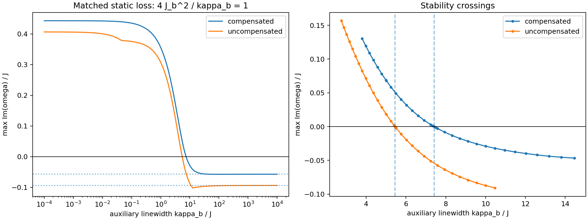

# Stability with matched non-Markovian auxiliary decay

## Result

For N=50, epsilon=38.51, J=1, U=-0.0002, V=0, Delta_a=0.5 and phi=pi/3, replacing direct kappa=1 loss by resonant local auxiliaries can destabilize both previously stable stationary backgrounds. We use Delta_b=0, no direct primary loss, and J_b=sqrt(kappa_b)/2, so 4*J_b^2/kappa_b=1. All primary stationary profiles remain exactly the same as in the Markovian problem; only dynamics and auxiliary populations change.

The compensated homogeneous intermediate state is stable for kappa_b>7.41212493*J. The uncompensated stationary state previously reached from vacuum is stable for kappa_b>5.45219985*J. Equality is marginal, and smaller positive linewidths are unstable for these respective branches. These are local linear-stability statements about fixed stationary states, not results of evolving from vacuum in the new model.

| Background | Critical kappa_b/J | J_b/J at crossing | Critical memory time J*tau_b | Markovian growth/J |
|:---|---:|---:|---:|---:|

| compensated | 7.412124929 | 1.361260898 | 0.269828156 | -0.057126665 |

| uncompensated | 5.452199853 | 1.167497308 | 0.366824411 | -0.093608639 |

Here tau_b=2/kappa_b. Thus increasing memory from the Markovian limit first destabilizes the compensated state. For 5.4522<kappa_b/J<7.4121 the uncompensated branch remains stable while the compensated branch is unstable; below 5.4522 both tested branches are unstable. This does not exclude additional stable stationary branches or nonstationary attractors.

## Numerical growth rates

Growth means max Im(omega) for i*dot(z)=L_ab*z. A negative value is asymptotic linear stability.

| kappa_b/J | J_b/J | Compensated growth/J | Uncompensated growth/J |
|---:|---:|---:|---:|

| 0.01 | 0.05 | 0.442103905 | 0.400221902 |

| 0.1 | 0.158114 | 0.434926849 | 0.375246600 |

| 1 | 0.5 | 0.355262493 | 0.307033643 |

| 2 | 0.707107 | 0.265126854 | 0.219278120 |

| 5 | 1.11803 | 0.068618266 | 0.018609674 |

| 10 | 1.58114 | -0.029061657 | -0.087347793 |

| 20 | 2.23607 | -0.052854963 | -0.098587074 |

| 100 | 5 | -0.057446259 | -0.094555991 |

| 1000 | 15.8114 | -0.057181350 | -0.093702359 |

The large-linewidth limit recovers the old Markovian growth rates. Convergence need not be monotonic: finite memory can slightly increase damping before longer memory causes instability. Decreasing kappa_b at fixed J_b would be a different comparison because it changes the stationary effective loss.

## Exact spectral mapping and threshold

Let L_a^(0) denote the primary-chain 2N-by-2N BdG operator at the chosen background, with the direct loss removed. Its blocks retain the onsite U*n^2 convention, including +U. Let lambda=x+i*y be any eigenvalue of L_a^(0). Since the resonant auxiliary particle and hole blocks are both -i*gamma_b times the identity, and the squared primary–auxiliary Nambu coupling is J_b^2 times the identity, the enlarged characteristic polynomial factorizes into scalar quadratic factors:

$$
(\omega-\lambda)(\omega+i\gamma_b)-J_b^2=0,
\qquad \gamma_b=\kappa_b/2,\quad J_b^2=\kappa_{\rm target}\gamma_b/2.
$$

Each lambda therefore gives two eigenvalues

$$
\omega_\pm=\frac{\lambda-i\gamma_b
\pm\sqrt{(\lambda+i\gamma_b)^2+4J_b^2}}{2}.
$$

This relation accounts for all 4N modes, including the auxiliary-like modes. The original Markovian spectrum is simply lambda-i*kappa_target/2. Both backgrounds have max y<kappa_target/2 but include modes with y>0: removing instantaneous damping exposes their gain, which the finite-bandwidth auxiliary reservoir may fail to suppress.

For y<=0, coupling this scalar mode to a damped auxiliary does not generate an instability. For 0<y<h, h=kappa_target/2, the two roots are strictly damped precisely when

$$
\gamma_b>y+|x|\sqrt{\frac{y}{h-y}}.
$$

Thus the full-chain threshold is

$$
\boxed{\kappa_{b,c}=2\max_{\lambda:\,0<y<h}
\left[y+|x|\sqrt{\frac{y}{h-y}}\right].}
$$

For nonzero x, this follows by setting a marginal omega real: the imaginary part of the quadratic gives omega=gamma_b*x/(gamma_b-y), and the real part gives y[1+x^2/(gamma_b-y)^2]=h. Stability requires gamma_b>y, selecting the upper crossing. The x=0 limit gives gamma_b,c=y. The high-linewidth branch is stable, and each scalar pair has only this stability boundary on gamma_b>y. Hence the matched family has no hidden reentrant stable interval below the reported threshold for these fixed backgrounds.

The modes that set the thresholds are:

| Background | Triggering primary eigenvalue lambda/J | Marginal frequency magnitude / J |
|:---|:---|---:|

| compensated | 1.200687510 + 0.440456373 i | 1.362633088 |

| uncompensated | -1.312948639 + 0.380699205 i | 1.526062969 |

Particle–hole symmetry supplies the opposite-frequency partner. The loss of stability is oscillatory (a finite-frequency linear crossing), not a stationary root disappearing. A nonlinear limit cycle is a possible subsequent behavior, but it has not been demonstrated here. The triggering mode need not be the least-damped mode in the Markovian limit; its nonzero frequency and the frequency-dependent reservoir response matter.

## Topology and stationary profiles

The compensated density remains n=1990.52082476 on every primary site. Its original endpoint compensation is held fixed, and beta_j=-i*sqrt(kappa_target/kappa_b)*alpha_j. The uncompensated primary profile is the previously computed vacuum attractor at epsilon=38.51, with no endpoint additions; it is inhomogeneous and already contains an extended nonzero frozen-winding segment. We are not comparing a trivial bulk with a topological bulk in this study.

At omega_ref=0, the matched primary Schur complement is exactly the original Markovian BdG operator for either profile. The homogeneous compensated bulk therefore retains its point-gap winding -1 along the entire matched family even after its dynamics becomes unstable. No point-gap closure at zero is required for this finite-frequency instability. **Preservation of zero-frequency topology and existence of a stationary profile do not guarantee dynamical stability.** The winding statement is a bulk statement for the homogeneous target; no quantized invariant is assigned to the inhomogeneous chain here.

## Methods and checks

The logarithmic scan contains 401 base linewidth values from 1e-4*J to 1e4*J, plus representative points and values bracketing each threshold by 1%. The analytic threshold is checked with a Brent root of the growth function (absolute linewidth tolerance 1e-11*J). The quadratic is evaluated using the root product to avoid cancellation when auxiliary and primary time scales are widely separated. Nine representative points per background, including both sides of each crossing, are independently diagonalized as full 200-by-200 matrices and in real-quadrature coordinates.

The installed real nonsymmetric eigensolver returned spurious eigenpairs with large residuals for these 200-dimensional generators. Those results are rejected. The real-coordinate matrices are instead cast to complex without changing any entries and diagonalized with the complex eigensolver; every accepted eigenpair set is checked against the original matrix. This agrees with the independent quadratic spectral mapping. This numerical issue is not interpreted as a physical instability.

For compensated: maximum full-spectrum mapping distance 6.46e-10J; maximum growth disagreement between particle/hole and real coordinates 3.52e-11J; maximum full eigenpair residual 8.2e-13; primary/auxiliary stationary force residuals below 3.52e-14J.

For uncompensated: maximum full-spectrum mapping distance 4.15e-10J; maximum growth disagreement between particle/hole and real coordinates 8.39e-12J; maximum full eigenpair residual 1.56e-12; primary/auxiliary stationary force residuals below 2.27e-13J.

The sign classification away from crossings uses a descriptive 1e-7*J resolution; the 1% brackets are well outside this band. Leading-eigenvalue condition numbers and first-order roundoff indicators are saved. The reported digits describe this N=50 finite-dimensional mean-field/BdG model, not a thermodynamic boundary or an interval-arithmetic certificate. No time evolution, basin study or fluctuation/noise calculation is performed, and no covariance feeds back into the stationary background.

Model and analytical conventions: [auxiliary-cavity derivation](../derivations/non_markovian_auxiliary_cavity_model.md). Reproduce with `python src/auxiliary_decay_stability.py`. Results: `data/generated/auxiliary_decay/stability.json`; figure: `figures/auxiliary_decay_stability.png`. Primary backgrounds are taken from the epsilon=38.51 entry in `data/generated/compensation_n50/intermediate_preparation_35_40.json`.
