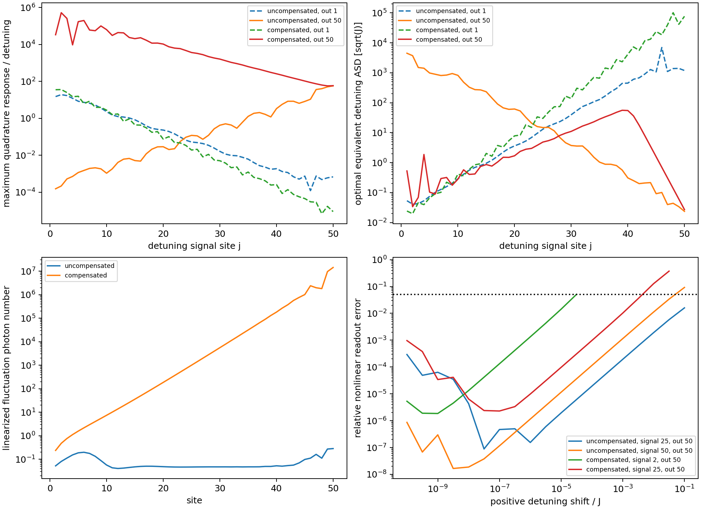

# Local-detuning sensing with and without boundary compensation

## Main finding

At N=50, epsilon=32, phi=pi/3, Delta=0.5, J=kappa=1, U=-0.0002 and V=0, the compensated intermediate state has a very large static signal response. **The amplified response is accompanied by amplified vacuum noise: large gain does not translate into a comparable improvement in detuning sensitivity.** More seriously, the linearized calculation predicts fluctuations much larger than the coherent background at the amplifying end. The compensated-state quantum sensitivity estimates below are therefore formal fixed-background BdG results, not a controlled prediction for a realizable quantum sensor at this operating point.

This study compares the previously prepared compensated homogeneous state (bulk winding -1 at omega=0) with the uncompensated vacuum attractor (trivial bulk). It uses mean-field backgrounds followed by Bogoliubov response/noise calculations. No fluctuation corrections are fed into the mean field and no covariance is evolved to find a stationary state.

## Measurement assumptions and definitions

Each site has an independent Markovian vacuum loss channel of rate kappa. Only one endpoint channel is measured at a time, with ideal, unit-efficiency homodyne detection; other output channels are unobserved. Coherent pumps are noiseless prescribed Hamiltonian drives. They are held fixed when a signal is applied, including the two boundary compensation fields. Any coherent drive background in a physical output is assumed calibrated/subtracted. We quote the coherent *emission contribution* kappa*|alpha|^2, not a total flux including interference with an incident pump. No detector noise, technical pump noise, fluctuating signal source or signal backaction is modeled. We estimate one known-position static detuning shift at a time, with an independently calibrated homodyne angle.

Define quadratures x=(delta a+delta a^dagger)/sqrt(2), p=(delta a-delta a^dagger)/(i*sqrt(2)), ordered r=(x_1,...,x_N,p_1,...,p_N). The full mean-field/BdG conventions remain i*dot(z)=L*z, with onsite U*n^2 and its +U shift retained. If A and B are the particle and pairing blocks, the real evolution generator is

```text
G = [[ Im(A+B),  Re(A-B)],
     [-Re(A+B),  Im(A-B)]].
```

For a local detuning shift deltaDelta_j, the signal force is f_j=sqrt(2)*(Im(alpha_j)*e_xj - Re(alpha_j)*e_pj). The zero-frequency intracavity response is R_j=-G^(-1)f_j. The Langevin equation and input-output relation are

```text
dot(r) = G*r + f_j*deltaDelta_j + sqrt(kappa)*r_in,
r_out  = r_in - sqrt(kappa)*r.
```

Thus the output signal slope is d_j=-sqrt(kappa)*R_j, while the zero-frequency vacuum scattering matrix is M=I+kappa*G^(-1). The full two-sided symmetrized output noise PSD matrix is C_out(0)=M*M^T/2. Vacuum quadrature PSD equals 1/2 in this convention. Keeping the identity in M includes the interference/correlations between directly reflected vacuum and cavity-emitted noise; simply adding shot noise to intracavity noise would be incorrect. These input-output and symmetrized-noise conventions follow the framework reviewed by [Clerk et al., Rev. Mod. Phys. 82, 1155 (2010)](https://arxiv.org/abs/0810.4729); the model-specific response matrices and numerical results here are new calculations.

At output site ell, let C_ell be its 2x2 output covariance spectral matrix and d_ell,j its two-component signal slope. A homodyne quadrature u=(cos(theta),sin(theta)) has slope u^T*d and PSD u^T*C*u. Its equivalent detuning amplitude spectral density is

```text
D_Delta = sqrt(u^T*C*u) / |u^T*d|,
u_opt proportional to C^(-1)*d,
D_Delta,opt = 1/sqrt(d^T*C^(-1)*d).
```

This noise-optimal quadrature generally differs from the maximum-signal quadrature u_gain=d/||d||. D_Delta has units sqrt(J). For a long averaging time T, the formal white-noise standard error is D_Delta/sqrt(T), with T in units 1/J. This is an ideal homodyne imprecision, not a quantum Fisher-information bound and not an optimization over joint multiport measurements.

## Signal and noise results

The signal site is scanned over all 50 sites, measuring each end separately and optimizing its homodyne angle. The best pair for each background is:

| Background | Signal site | Output site | theta (rad) | Signal slope | Noise PSD | Equivalent detuning ASD / sqrt(J) |
|:---|---:|---:|---:|---:|---:|---:|
| uncompensated | 50 | 50 | 0.014374 | 37.6604 | 0.798579 | 0.02372871 |
| compensated | 2 | 1 | -1.911080 | 30.5899 | 0.367313 | 0.01981258 |

The formal best compensated noise floor is only about 1.20 times better than the best uncompensated floor, despite the much larger unrestricted resolvent gain. These optima use different signal locations; they are not an equal-location comparison.

For the compensated state's most amplified route, signal at site 2 and output at site 50, the maximum-signal slope is 5.27078e5 and the noise PSD in that quadrature is 3.20788e8. Their ratio gives an equivalent detuning ASD of 0.0339808*sqrt(J), worse than the compensated state's low-gain optimal measurement at site 1. The noise-optimal and maximum-signal quadratures on this amplified route give essentially the same floor.

At the same signal site 2, using output site 1, the noise-optimal ASD is 0.0412172*sqrt(J) without compensation and 0.0198126*sqrt(J) with compensation: a formal factor 2.08. For a central signal at site 25, the best endpoint ASD changes from 13.0818*sqrt(J) without compensation to 4.86568*sqrt(J) with compensation (output 50 for the latter). This illustrates the strong dependence on both perturbation position and readout choice. It is not a universal topological sensing advantage.



## Resources and a crucial consistency check

| Quantity | Uncompensated | Compensated |
|:---|---:|---:|
| Total coherent photon population | 30831.31 | 149429.9 |
| Total coherent emission / J | 30831.31 | 149429.9 |
| Left endpoint coherent emission / J | 197.3061 | 2988.597 |
| Right endpoint coherent emission / J | 1936.616 | 2988.597 |
| Maximum linearized fluctuation photons at a site | 0.2831249 | 1.434576e+07 |
| Maximum fluctuation/coherent population ratio | 0.0004184077 | 4800.166 |

The compensated state uses 4.85 times more coherent photons. A descriptive population-normalized metric D_Delta*sqrt(total coherent population), lower being better, is about 1.84 times worse for its individually optimized measurement. This is a resource comparison at the two operating points, not a demonstrated equal-resource optimum or an accounting of pump power and local-oscillator resources.

For consistency only, we solve the stationary *linearized* Lyapunov equation G*V+V*G^T=-(kappa/2)*I. Its fluctuation photon population is n_fl,j=(V_xjxj+V_pjpj-1)/2. This is a diagnostic after fixing the mean field, not a self-consistent Gaussian stationary solver.

The compensated state has roughly 1.43e7 predicted fluctuation photons at site 50, compared with a coherent density of 2988.6: a ratio about 4800. The total predicted fluctuation population is 3.37e7. **The small-fluctuation expansion fails this consistency check.** Negative BdG eigenvalue growth rates guarantee stability of the linear equations but do not guarantee small vacuum-driven fluctuations in a non-normal amplifier. Consequently none of the apparent compensated-state quantum sensitivity advantages here should be treated as established physical performance. The uncompensated state passes this check much better: its largest local fluctuation/coherent ratio is 4.18e-4.

## Nonlinear stationary response checks

For the optimized signal location of each state and for site 25, we apply positive and negative shifts from 1e-10*J to 0.1*J in half-decade steps. Each perturbed stationary solve starts from the unperturbed state plus its full linear prediction, with pumps unchanged. We check the nonlinear output shift against the predicted slope at a *fixed* noise-optimal homodyne angle calibrated at zero signal; output noise is not recomputed at finite signal. The following are the last contiguous sampled magnitudes, starting at the first numerically resolved weak-signal point (absolute predicted quadrature shift above 1e-8), for which the solver converges, the root is BdG stable, and the readout error is below 5%:

| Background | Signal site | Output site | Negative-shift magnitude / J | Positive-shift magnitude / J |
|:---|---:|---:|---:|---:|
| uncompensated | 25 | 1 | 0.1 | 0.1 |
| uncompensated | 25 | 50 | 0.1 | 0.1 |
| uncompensated | 50 | 1 | 0.031623 | 0.031623 |
| uncompensated | 50 | 50 | 0.031623 | 0.031623 |
| compensated | 2 | 1 | 0.001 | 3.1623e-05 |
| compensated | 2 | 50 | 3.1623e-05 | 1e-05 |
| compensated | 25 | 1 | 0.1 | 0.031623 |
| compensated | 25 | 50 | 0.01 | 0.0031623 |

These are sampled local-root checks, not certified dynamical switching thresholds. A solver failure does not establish loss of the branch, and a converged root need not be the attractor reached by suddenly applying a finite signal. No finite-signal time-evolution or rare switching simulation is claimed. The asymmetry between signal signs reflects nonlinear response and branch/basin structure. Mean-field agreement at weak signals validates the deterministic susceptibility, not the validity of the compensated quantum-noise expansion.

## Verification, reproducibility and interpretation

The real-quadrature susceptibility is independently checked against -L^(-1)*diag(alpha,-alpha*) in particle/hole coordinates. A passive U=0 reference has exactly vacuum output PSD=I/2, checking the direct-input interference and normalization. The all-port zero-frequency scattering matrix preserves quadrature commutators to maximum absolute error 4.9e-8 in the compensated case and below 1e-15 in the uncompensated case; cancellation involves large amplified coefficients. Relative Lyapunov residuals are below 1.2e-14. The reference stationary residuals are below 1e-9; all individual perturbed residuals, convergence flags and growth rates are retained, including failed solves. Densities and both original vacuum/ramp preparation histories come from the existing validated epsilon=32 dataset.

The calculation demonstrates a classical signal amplifier and shows why topology/large susceptibility alone do not establish quantum-enhanced sensing. A useful next step is to look for a shorter chain or a less strongly amplified operating point where fluctuation populations remain small, then repeat the same physical-signal and noise comparison. Technical compensation noise and finite efficiency would also need evaluation before drawing experimental conclusions.

Reproduce with `python src/compensated_sensing_pilot.py`. Full per-site sensitivities, output covariance spectra at zero frequency, optimal homodyne angles, nonlinear root checks and fluctuation diagnostics are saved in `data/generated/compensated_sensing/sensing.json`. Source mean fields and preparation data: `data/generated/compensation_n50/preparation_30_35/epsilon_32.000000.json`. Only this separate report is written by the script; the previous cumulative report is unchanged.
