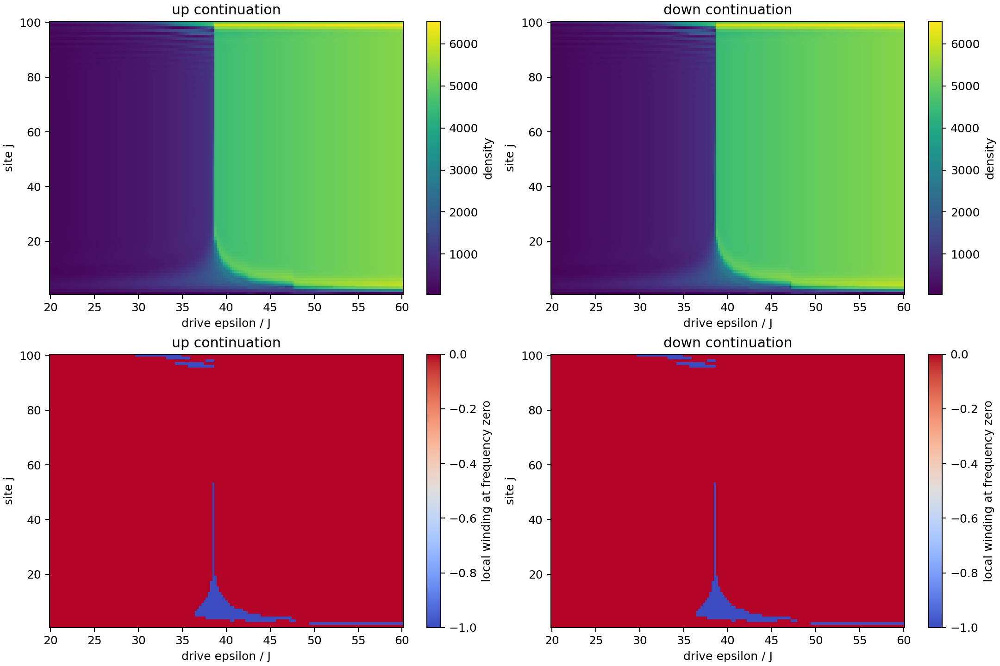
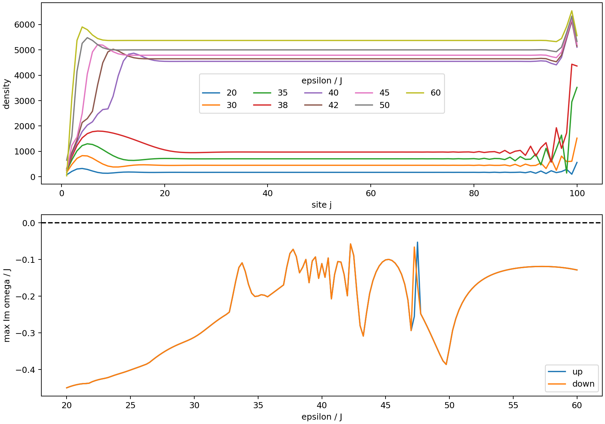
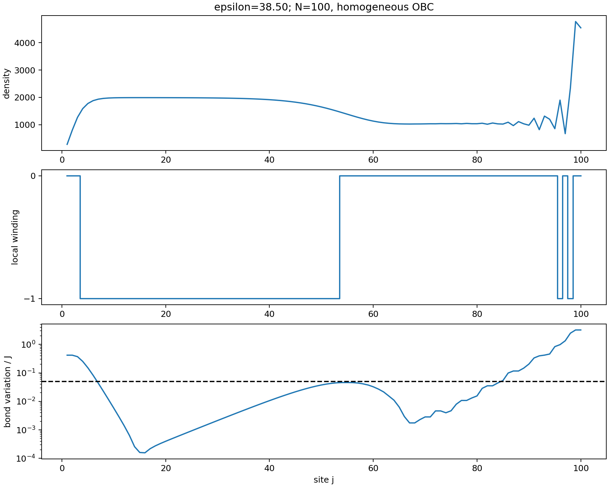

# Homogeneous driven OBC chain: N=100, Delta=0.5

Calculated 2026-11-04. This is a mean-field stationary-state calculation followed by Bogoliubov analysis, with no Gaussian covariance evolution or feedback. These are new numerical observations, not a reproduction of the paper's Gaussian phase diagram.

## Parameters and conventions

J=1, U=-0.0002, kappa=1, phi=pi/3, Delta=0.5, V=0, N=100; epsilon runs from 20 to 60. All rates are in units J and time in 1/J. Drive and detuning are uniform on every site, including both edges. Sites are 1 through 100; only bonds (j,j+1) are present. In the real-drive gauge T[j+1,j]=J exp(+i phi). Homogeneous parameters do not require a homogeneous stationary density under OBC.

The Hamiltonian onsite convention is U n_j^2, so normal ordering retains the +U shift:

`i d alpha_j/dt = epsilon + (Delta+U-i kappa/2+2U|alpha_j|^2) alpha_j + J exp(-i phi) alpha_(j+1) + J exp(+i phi) alpha_(j-1)`.

Missing neighbours are omitted. Density means n_j=|alpha_j|^2. We solve the complex stationary force f=0. Fluctuations obey i dz/dt=L z, L=[[A,B],[-B*, -A*]], A=T+diag(Delta+U+4Un-i kappa/2), B=diag(2U alpha^2). Modes evolve as exp(-i omega t); stability therefore requires max Im(omega)<0 (classification tolerance 1e-7).

## Results

All 161 sampled drives (spacing 0.25) admit a converged, linearly stable stationary solution in both continuation directions. Maximum residual max_j|f_j| is 7.99e-09. The least negative computed growth rate is -0.052781. Up/down profiles agree to 1.61e+03 in maximum absolute density difference; distinct stable profiles occur at epsilon=47.25 and 47.50, providing evidence of a small hysteretic or multistable interval. The other sampled drives agree within 0.01 in absolute density. This does not enumerate all stationary branches.

Low drives have a low-density interior with appreciable boundary distortions. Near epsilon=38.5 an extended, slowly varying intermediate-density domain develops. Beyond this narrow crossover the interior is high density, with a low-density segment and an interface towards the left end. Increasing drive moves the interface leftwards. Even at epsilon=60 the end-site density is strongly different from the bulk. A description in terms of uniform density phases alone misses these spatial structures.

| epsilon | mean density | min-max density | max Im omega | nonzero frozen local winding: sites | smallest singular value |
|---:|---:|---:|---:|---|---:|
| 20 | 182.65 | 77.49-564.41 | -0.44950 | none | 0.464 |
| 30 | 480.95 | 173.61-1522.81 | -0.31181 | 100 | 0.305 |
| 35 | 793.81 | 146.55-3521.40 | -0.19958 | 97, 99 | 0.0714 |
| 38 | 1147.14 | 277.21-4434.62 | -0.09175 | 4-13, 96, 98 | 0.0749 |
| 38.5 | 1572.51 | 284.45-4771.48 | -0.12118 | 4-53, 96, 98 | 0.000122 |
| 38.75 | 4052.96 | 287.43-6105.78 | -0.09981 | 4-19 | 0.00464 |
| 40 | 4323.26 | 296.45-6130.47 | -0.11110 | 4-10 | 0.0284 |
| 42 | 4497.12 | 329.32-6170.20 | -0.19887 | 4-6 | 0.043 |
| 45 | 4685.81 | 257.24-6230.41 | -0.10102 | 3-4 | 0.13 |
| 48 | 4864.23 | 799.70-6291.33 | -0.26451 | none | 0.106 |
| 50 | 4951.27 | 653.19-6332.29 | -0.34098 | 2 | 0.194 |
| 60 | 5326.21 | 37.63-6540.29 | -0.12849 | 2 | 0.392 |





## Topology: definition and interpretation

We explicitly checked the main paper and Section VI, Eqs. (15)-(22), of the [accessible arXiv v1 supplemental text](https://arxiv.org/html/2411.08965v1#S6). This is not a claim to have inspected a separate published supplement. The published main source is [Rassaert et al., PRL 135, 203603 (2025)](https://doi.org/10.1103/w32k-x3l5), stored in literature/papers/RassaertPRL2025.pdf.

At reference frequency omega_0=0, Q=-L, and H_ext=[[0,Q],[Q^dagger,0]]. Its chiral symmetry operator is diag(I,-I); its energies are plus/minus the singular values of Q. For the frozen homogeneous symbol at site j define d_j=Delta+U+4Un_j, b_j=2U alpha_j^2. With Fourier convention exp(+ikj),

`L_j(k)=(2J sin(phi) sin(k)-i kappa/2) I + [[d_j+2J cos(phi) cos(k), b_j],[-b_j*, -d_j-2J cos(phi) cos(k)]]`.

The local diagnostic is nu_j=(1/2pi) Delta_arg det[-L_j(k)] over increasing k from -pi to pi. Let X0=|b_j|^2-(kappa/2)^2-(d_j+2J cos(phi))^2 and Xpi=|b_j|^2-(kappa/2)^2-(d_j-2J cos(phi))^2. Nonzero winding occurs exactly when X0 Xpi<0; its sign is sign(d_j) for this gauge. Thus nontrivial sites here have nu=-1; reversing orientation reverses the sign. At either zero the point gap closes and the winding is undefined. The phase of b does not change the frozen invariant, but its spatial variation matters for using it locally.

The main extended topological candidate is near epsilon=38.5, rather than every isolated coloured pixel in the local map. On the refined 0.01 grid (38.25-38.80), the largest domain occurs at epsilon=38.50, with nonzero winding on sites 4-53, 96, 98. Sites 7-53 also satisfy the descriptive slow-variation check max(|d_(j+1)-d_j|,|b_(j+1)-b_j|)<0.05J on adjacent bonds. This threshold is a diagnostic, not a rigorous error bound. Near a local gap closing even small variation can invalidate a frozen-bulk interpretation. At the selected point all 100 analytic winding labels agree with a 16384-point numerical momentum winding.



At this point s_min=0.000122478, s_next=0.0434942; the right/left smallest-singular-vector centres are 53.17 and 4.59. This provides a finite-chain SVD response diagnostic for the inhomogeneous operator, independently of the local approximation. It does not by itself establish protected modes or asymptotic exponential scaling. Most one- or two-site nonzero regions at other drives occur in rapidly varying boundary layers and cannot be identified confidently as local bulk topological phases. Topology and dynamical stability remain separate diagnostics.

## Numerical method, checks, and limits

Root solving uses the analytic real Jacobian, scipy.optimize.root with tol=1e-10, and acceptance max|f|<1e-8. Each sweep begins from vacuum at its endpoint; subsequent points use the previous profile. If a root fails or is unstable, mean-field DOP853 evolution over t=400 (rtol=2e-8, atol=2e-9) supplies another seed. A failed solve is never classified as absence of a stationary state. The refined scan continues from epsilon=38.25 using 0.01 steps, with a t=1200 tighter-tolerance evolution fallback when a root fails.

Independent vacuum starts at epsilon=20,30,35,38,40,42,45,50,60 were evolved to t=1200 with rtol=2e-10, atol=2e-11 and root polished. They agree with the up-sweep densities to 2.9e-08; polished residuals are below 1.11e-13. The largest temporal density standard deviation over the final 50 time units is 1.39e-05, consistent with numerical integration error. The existing validation driver independently verifies the Jacobian against finite differences and the PBC spectrum against its Bloch form.

Spectra and SVD use double precision. No thermodynamic phase boundary, size scaling, proof of uniqueness, or exhaustive search for unstable/disconnected branches is claimed. The narrow topological crossover is resolved at 0.01 only within the stated refinement window; the wider scan has 0.25 resolution. N is held at the requested 100, so finite-size dependence is not established. A nonzero frozen invariant in a short, rapidly varying region is reported as a candidate diagnostic, not a proven topological domain.

## Reproducibility and files

Run from the project root with numpy, scipy, matplotlib:

```powershell
python src/scan_homogeneous_obc.py
python src/refine_homogeneous_obc.py
python src/validate_mean_field.py
```

This session used C:/Users/diego/miniconda3/envs/topo/python.exe. Reusable drivers are in src/. Full parameters are fixed explicitly in the code and above. Full complex amplitudes, densities, residuals, growth rates, local winding, variation diagnostics, and singular data are in data/generated/homogeneous_obc_n100/scan.json and refinement.json; independent-start checks are in checks.json. density_up.csv contains every up-sweep density profile. Generated datasets are excluded from git; rerun the drivers to regenerate them.
