# Would the topological segment be stable as a homogeneous OBC chain?

Yes, for the frozen Bogoliubov coefficients tested here. In particular, the extended topological segment at epsilon=38.50 remains dynamically stable when its representative local coefficients are repeated uniformly along an isolated open chain. The adjoining trivial portions of the original profile are therefore not necessary for stability of these uniform quadratic examples.

## Precisely what is compared

We use the stationary mean-field scan in [the original report](homogeneous_obc_n100_results.md): J=1, U=-0.0002, Delta=0.5, kappa=1, phi=pi/3, V=0. Site indexing starts at 1, forward hopping is J exp(+i phi), and fluctuations evolve as exp(-i omega t). Growth means Gamma=max Im(omega); Gamma<0 is stable.

For each contiguous nonzero-local-winding segment, we take its minimum, median, and maximum density n, and construct a **uniform quadratic OBC operator** with

`d = Delta + U + 4 U n = 0.4998 - 0.0008 n`,

`|g| = |2 U alpha^2| = 0.0004 n`,

`L = [[T + (d-i/2)I, g I],[-g* I, -T* + (-d-i/2)I]]`.

A global Nambu rotation makes g real and positive without changing any eigenvalue or hopping coefficient. We test both the actual segment length and length 100, without tapering coefficients or adding boundary loss. The local winding uses the same zero-frequency point gap and Fourier exp(+ikj) convention as the original report.

This isolates the effect of imposing OBC on a uniform Bogoliubov operator. It does **not** recalculate the mean-field background after cutting a nonlinear chain. A repeated constant alpha generally fails the original mean-field equation at its newly exposed ends because a hopping term is missing. Consequently these results do not assert that a uniformly pumped nonlinear chain will realize that exact constant background. Boundary drives could enforce it, but that would be a different driving profile.

## Main example: epsilon=38.50

The extended local topological segment is sites 4-53 (50 sites). Its density runs from 1499.19 to 1991.14, and its median density is 1966.18. The original full inhomogeneous N=100 chain has Gamma=-0.121184.

| Uniform density | d | abs(g) | Gamma OBC, length 50 | Gamma OBC, length 100 | Gamma continuous PBC bulk |
|---:|---:|---:|---:|---:|---:|
|1499.19|-0.699549|0.599675|-0.088227|-0.087384|+0.099675|
|1966.18|-1.073142|0.786471|-0.058753|-0.053245|+0.283063|
|1991.14|-1.093115|0.796458|-0.057090|-0.051418|+0.290996|

All three uniform backgrounds have nonzero zero-frequency winding, nu=-1 in our orientation. They are stable with OBC at both lengths, while their real-momentum PBC bulk has growing modes. The full inhomogeneous chain decays faster than these uniform examples, so the profile changes the stability margin even though it is not essential to obtaining a negative growth rate in this test.

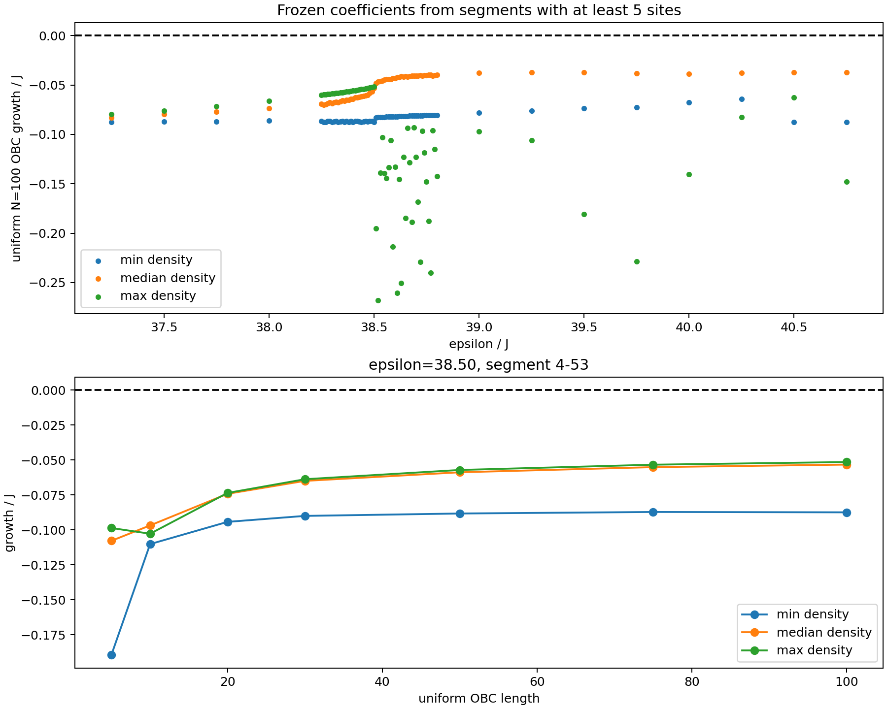

The lower panel holds each set of coefficients fixed while changing only length through 5,10,20,30,50,75,100. Every tested length remains stable. No infinite-length stability theorem is inferred from this finite set.

## Interval 35 < epsilon < 45

The calculation covers the original 0.25 up-sweep grid strictly within this interval plus the 0.01 refinement between 38.25 and 38.80. For all 156 contiguous candidate segments, including isolated boundary-site winding signals, minimum/median/maximum density tests at the segment length and length 100 give 936 stable spectra. The least negative computed rate is -0.036937, from an N=100 repetition of the density of isolated site 98 at epsilon=38.50. The figure's upper panel includes only segments of at least five sites to keep extended domains distinct from isolated boundary signals.

This samples representative coefficients rather than proving stability for every intermediate density or every epsilon. It uses the up-sweep branch; the previous scan found no resolved branch difference in 35<epsilon<45. Rapidly varying and very short segments retain the local-topology caveats in the original report. Their uniformized quadratic counterparts are nevertheless well-defined test operators.

## Stationary density profiles in the interval

The following panels show the original full N=100 stationary mean-field profiles for representative drives strictly inside 35<epsilon<45. Blue curves are n_j=|alpha_j|^2; amber shading and dots mark sites with nonzero frozen local winding at zero frequency. The shading is a local diagnostic: isolated sites and rapidly varying boundary regions do not establish an extended bulk topological phase. These are the inhomogeneous backgrounds from which the uniform BdG test coefficients were extracted.

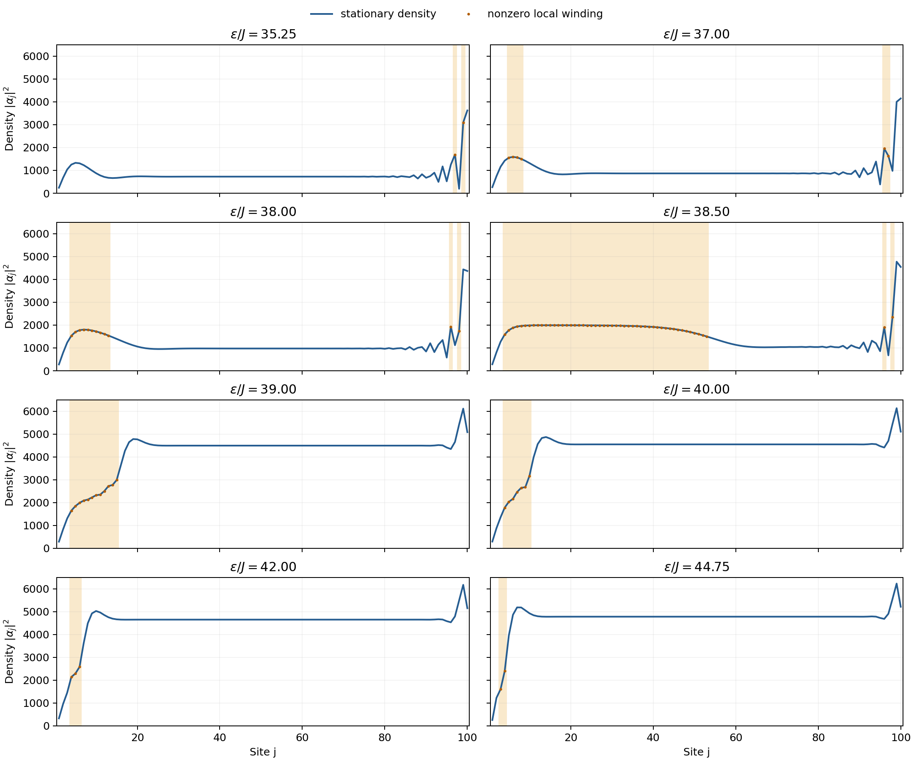

A closer series around epsilon=38.50 resolves the extended intermediate-density region and its replacement by a high-density interior. Each panel uses the same density scale. At epsilon=38.50, the extended shaded segment spans sites 4-53; its minimum, median, and maximum densities define the three uniform examples in the table above. The three density choices correspond to the same epsilon, rather than three different drives.

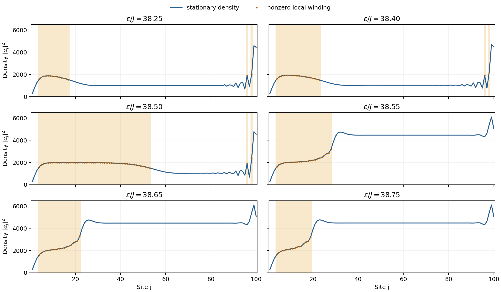

These figures use saved up-sweep and refined-scan solutions and require no new stationary solves. Regenerate them with `python src/plot_topological_segment_profiles.py` from the project root.

## PBC comparison and analytical interpretation

With these same fixed uniform coefficients, the Bloch frequencies are

`omega_±(k) = 2 J sin(phi) sin(k) - i gamma ± sqrt[(d+2 J cos(phi) cos(k))^2-|g|^2]`,

where gamma=kappa/2=0.5. Thus, for continuous real k,

`Gamma_PBC = -gamma + sqrt(max(0, |g|^2 - max(|d|-2|J cos(phi)|,0)^2))`.

This yields the positive rates in the table. They are continuous-momentum bulk rates, rather than rates of a finite ring with a specific discrete momentum grid. The corresponding ring convention would put phase +phi on every forward bond, including (N,1), with total twist N phi modulo 2pi.

The real-k Bloch growth criterion cannot determine OBC stability. Imposing OBC changes the admissible modes of this non-Hermitian operator. Numerically, those modes all decay for the coefficients above despite growing PBC Bloch modes. This establishes the boundary-condition contrast at fixed coefficients without invoking a change in the nonlinear background. A derivation of the full OBC spectrum or a proof of a convective-instability mechanism remains separate work; topology alone does not guarantee OBC stability in general.

## Numerical verification and reproducibility

The double-precision eigenvalue calculation records dominant eigenvalue condition numbers, residuals, and first-order sensitivity indicators. For the main example at length 100, dominant condition numbers are about 1.3e8-2.1e8 and sensitivity indicators about 1e-7-2e-7. The reported last digits are therefore approximate; the negative stability margins are much larger than these indicators.

For the six main-example combinations (three densities, lengths 50 and 100), an independent real-quadrature banded characteristic polynomial and Routh count were computed at both 100 and 160 decimal digits. All give zero roots with Re(lambda)>0 for the generator lambda=-i omega; both precisions agree also on counts to the right of -0.1 and +0.1. This independently supports the stable/unstable classification despite eigenvalue sensitivity. Decimal checks are precision convergence evidence, not interval-arithmetic certificates. High precision was not repeated for every one of the 936 spectra.

Driver: [src/test_uniform_topological_segments.py](../src/test_uniform_topological_segments.py). Run from the project root:

```powershell
python src/test_uniform_topological_segments.py
```

This session used C:/Users/diego/miniconda3/envs/topo/python.exe. Inputs are scan.json and refinement.json in data/generated/homogeneous_obc_n100/. Outputs are uniform_segment_tests.json and uniform_segment_precision.json in the same directory, plus the tracked figure above. Parameters and selected density coefficients are saved with each numerical record. No stationary solver, covariance evolution, or fluctuation feedback enters this fixed-background comparison.

## Finer scan: epsilon spacing 0.01 across 35-45

Added 2026-11-04. Parameters, homogeneous drive/detuning, N=100, OBC, V=0, and all sign and topology conventions remain as above. The full interval is now scanned at **0.01 spacing**, rather than 0.25. Each direction contains 1001 points, including endpoints 35 and 45 as continuation anchors; the strict interior contains 999 points per direction. Both directions were recalculated independently from their respective coarse-scan endpoint solutions.

### Convergence and full-chain stability

Across 2002 stationary attempts there are 0 failed solves; maximum stationary residual is 3.87e-09. The largest full-chain growth rate is -0.044049 J. Stability classification uses tolerance 1e-7 J. Root tolerance is 1e-10, acceptance max|f|<1e-8; failed or unstable roots trigger mean-field evolution to t=1200 with rtol=2e-10, atol=2e-11 before another solve. No covariance equations are evolved.

The largest up/down density difference is 2.68766e-07. There are 0 sampled drives with maximum site-density difference above 0.01 between directions.  These are finite-step continuation comparisons, not an exhaustive branch enumeration.

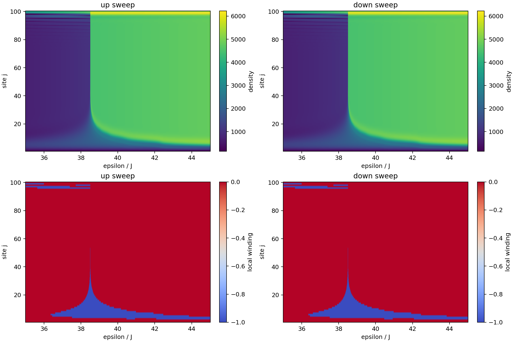

### Resolving the narrow topological crossover

The up-sweep's most extended slowly varying candidate occurs at epsilon=38.50: 47 sites have both nonzero frozen winding and adjacent-bond variation below 0.05J. This uses the same descriptive variation criterion as the earlier report, not a controlled error bound near local gap closures. The first and last drives with a contiguous winding segment of at least five sites are 37.21 and 40.97; this span alone does not imply a single homogeneous phase or certify slow variation throughout it.

|epsilon|mean density|longest nonzero-winding segment (sites)|full-chain growth / J|smallest singular value / J|
|---:|---:|---:|---:|---:|
|38.45|1322.04|24|-0.131262|0.00917255|
|38.46|1335.50|25|-0.131068|0.00740454|
|38.47|1352.47|27|-0.130903|0.00561638|
|38.48|1375.78|29|-0.130795|0.00380724|
|38.49|1414.15|33|-0.130841|0.00197627|
|38.50|1572.51|50|-0.121184|0.000122478|
|38.51|3584.97|35|-0.093588|0.000159441|
|38.52|3690.16|31|-0.093367|0.00034267|
|38.53|3750.50|28|-0.097417|0.000521575|
|38.54|3792.38|26|-0.090310|0.00065468|
|38.55|3824.86|25|-0.095865|0.000886693|

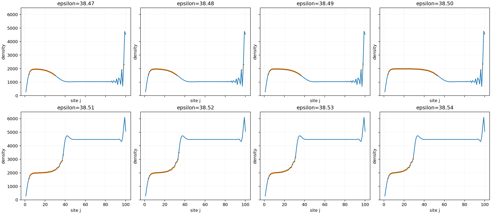

The profiles are full nonlinear stationary backgrounds; the uniform chains below are fixed-coefficient quadratic comparisons. The dots include short boundary signals and therefore retain the earlier local-topology caveats.

### Does the uniform-OBC stability conclusion survive refinement?

At each strict-interior up-sweep point we select the longest contiguous candidate segment and repeat its minimum, median, and maximum density coefficients uniformly. Both its own length and length 100 are tested. The 5994 resulting spectra contain 0 growing cases above 1e-7 J. The least negative rate is -0.036936 J, at epsilon=39.61, density 2347.574, length 100, using the median density sample. This is a representative-coefficient search, not proof for all densities between those samples. Only the longest segment is retested on the fine grid; the earlier coarser calculation included all segments.

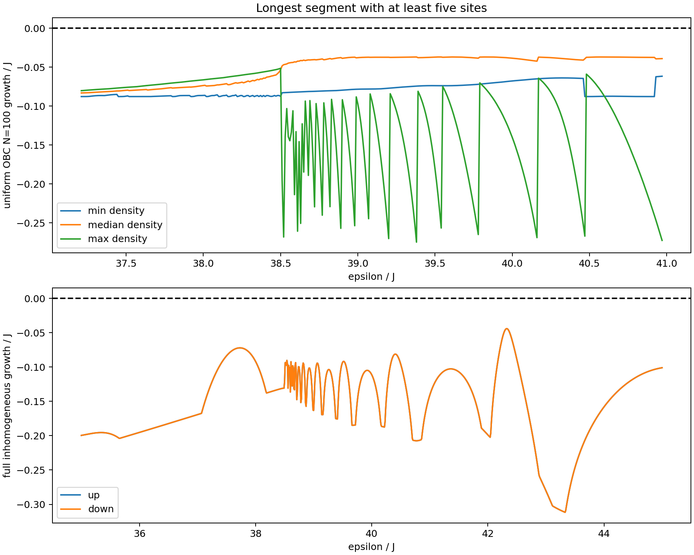

For the least stable uniform example, independent Decimal characteristic-polynomial/Routh calculations at 100 and 160 digits both find 0 growing generator eigenvalues to the right of zero. Counts also agree at shifts -0.1 and +0.1. This checks its stable/unstable label despite non-Hermitian eigenvalue conditioning; it does not certify every spectrum with interval arithmetic. Previously established high-precision checks for epsilon=38.50 still apply.

The fine calculation therefore tests whether the earlier stable uniform-OBC examples persist under closer sampling. It does not change the distinction between a uniform quadratic operator and a newly solved nonlinear chain after cutting boundaries, nor does it imply that stability suppresses transient or noise amplification.

### Reproduce the additional calculation

```powershell
python src/fine_scan_topological_segments.py
python src/report_fine_scan.py
```

The scan is resumable from saved checkpoints. Session interpreter: C:/Users/diego/miniconda3/envs/topo/python.exe. Saved records are fine_scan_35_45.json (complex amplitudes, densities, convergence, full-chain growth, winding, SVD and variation), fine_uniform_segment_tests.json (sampled uniform coefficients, growth, residuals and conditioning), and fine_scan_summary.json (comparison and precision checks), all under data/generated/homogeneous_obc_n100/. The coarse figures and results above are retained for comparison; use this section for the refined scan.

## Endpoint-compensation experiment at epsilon=38.51

This experiment separates stationary-background selection from BdG stability. It supports the interpretation that a stable topological background can be strongly deformed by boundary forcing; it does not establish a general front-selection theory.

### Construction

The three homogeneous bulk roots satisfy

`epsilon^2 = n [(Delta+U+2J cos(phi)+2Un)^2+(kappa/2)^2]`,

with `alpha0=-epsilon/(Delta+U+2J cos(phi)+2Un-i kappa/2)`.

For each root independently, set the additive complex endpoint drives to

`pump_1(s)=epsilon+s J exp(+i phi) alpha0`,

`pump_N(s)=epsilon+s J exp(-i phi) alpha0`.

Interior drives are unchanged. The complex drive Hamiltonian is pump_j a_j^dagger + pump_j* a_j. These fixed external terms replace the mean field of the missing left/right neighbours at s=1; they do not couple to fluctuations. At s=1 the uniform profile is therefore an exact OBC stationary solution. At s=0 the model is exactly the original uniformly driven open chain. The different bulk roots define different endpoint-drive paths for 0<s<=1, although all paths end at the same model at s=0.

The code verifies initial stationary residuals below 1e-10 and exact equality of compensated/uncompensated BdG matrices evaluated at the same uniform background. Along the path the background changes, so its BdG matrix generally changes too.

### Results: stability versus boundary sensitivity

|starting root|uniform density|growth at s=1 / J|smallest singular value at s=1 / J|max abs(d alpha_j/ds) at s=1|last locally continued s|
|---|---:|---:|---:|---:|---:|
|low|1042.712|-0.128514|0.3614|30.51|0.526985818|
|middle|1990.521|-0.051460|1.377e-08|1.151e+09|0.347470726|
|high|4465.768|-0.500000|0.3418|64.55|0.000000000|

All three starting uniform OBC backgrounds are linearly stable. Nevertheless, the intermediate topological root has a dramatically larger response to the particular missing-neighbour forcing. This is not inferred just from its small singular value: we explicitly solve

`L z' = -(q,-q*)`,

where q_1=J exp(+i phi) alpha0 and q_N=J exp(-i phi) alpha0, other entries vanish, and the first N components of z' give d alpha/ds. The intermediate result max abs(d alpha/ds)=1.15e9 means that tiny changes of compensation can cause substantial deformation. It is a local derivative, not a finite-amplitude prediction outside linear response.

The intermediate branch can be continued beyond the uniform point if compensation steps begin at 1e-11. The original minimum step of about 1e-7 was inadequate; its failure did not indicate absence of a stationary branch. The refined branch shows the following actual nonlinear changes:

|removed compensation 1-s|mean density|growth / J|
|---:|---:|---:|
|9.763e-10|1988.335|-0.051780|
|9.603e-09|1971.599|-0.053513|
|1.017e-07|1885.116|-0.066422|
|1.035e-06|1753.116|-0.095132|
|0.009788|1237.177|-0.129209|

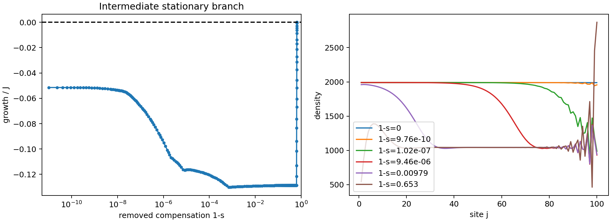

Thus **substantial inhomogeneity develops while the intermediate branch remains stable at the displayed points**. A dynamical instability is not necessary to obtain that deformation. The full OBC operator has large static susceptibility despite decaying eigenmodes.

### Continuation and dynamics are separate observations

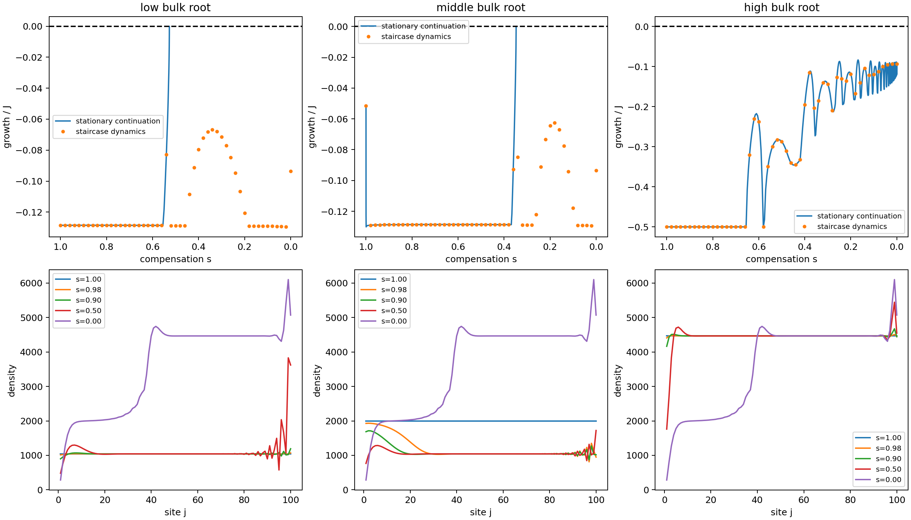

The high-root stationary branch is followed continuously from s=1 to s=0 and stays stable: its largest computed growth along the path is -0.083644 J. It ends at the original inhomogeneous profile. This is the clearest example of a stable homogeneous background deforming into the observed nonuniform state without a resolved stability loss.

Local continuation from the low root stops near s=0.526985818, with the final computed growth -0.00015 J. The refined intermediate path stops near s=0.347470726, with growth 1.1e-08 J. These near-marginal endpoints are consistent with branch turning or bifurcation, but the stopping rule is numerical: root acceptance fails or the permitted profile step becomes too small. Pseudo-arclength continuation is needed to establish the branch geometry. No fold is claimed as proven. Growth magnitudes below 1e-7 J are treated as marginal/unresolved; the intermediate path has no resolved positive growth above that threshold.

Separately, all three initial conditions were evolved under a staircase protocol s=1,0.98,...,0. Each step runs to t=1200 with DOP853, rtol=2e-10, atol=2e-11, starting from the preceding endpoint. All 153 steps finish close to root-polished stationary solutions (max amplitude distance <1e-3 and max force <1e-3). The reported profiles use these reached stationary roots; the integration endpoint, final-50-time density variation, and root distance are recorded separately. This protocol has finite drive steps and does not locate bifurcations precisely. In particular, its first intermediate-root step skips the extremely narrow near-s=1 deformation scale.

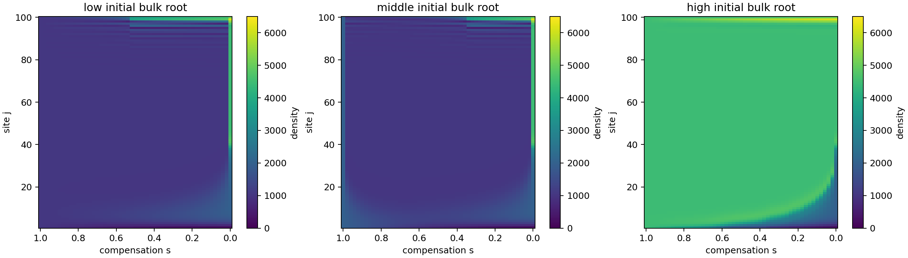

At s=0 all three protocols recover the original epsilon=38.51 profile, with maximum site-density differences 6.25e-10, 6.69e-10, 7.58e-10 for low/middle/high starts respectively. This is evidence for a common selected endpoint under these protocols, not proof of uniqueness or absence of other basins.

### What this establishes

The compensation experiment weakens the explanation that spatial variation is required only as a stabilizing taper. It supplies a concrete alternative: open boundaries impose a finite stationary mismatch, and a linearly stable topological background can respond extremely strongly to that mismatch. The nonlinear stationary equations then determine a deformed profile, potentially connecting different bulk density branches. The high-root continuation demonstrates stable deformation all the way to the target model; the intermediate-root response demonstrates the extreme sensitivity most directly.

The results do not yet establish that topology is the unique cause of the sensitivity, a universal relation between topology and profile selection, or an analytic law for interface position. Comparisons with phi=0 or reversed phi, system-size scaling, and pseudo-arclength continuation would address those remaining questions. The susceptibility calculation is specific to the physical endpoint-forcing vector, which is more informative here than the norm of L inverse alone.

### Reproduce and numerical limits

```powershell
python src/endpoint_compensation.py
python src/refine_endpoint_compensation.py
python src/report_endpoint_compensation.py
```

All parameters remain N=100, J=1, U=-0.0002, V=0, Delta=0.5, kappa=1, phi=pi/3. The bulk drive is fixed at epsilon=38.51. Stationary root tolerance is 1e-10, acceptance max|f|<1e-8. Local continuation uses secant prediction, maximum compensation step 0.005, step halving after failure or excessive amplitude change; the initial runs reject changes above 2 and stop below step 1e-7, while the intermediate refinement rejects changes above 1 and stops below 1e-13. This is parameter continuation, not pseudo-arclength continuation.

All complex amplitudes, densities, stationary growth, residuals, singular diagnostics, failed steps, and time-evolution convergence diagnostics are saved in data/generated/homogeneous_obc_n100/endpoint_compensation.json. The near-uniform intermediate operator is highly nonnormal; calculations here use double precision. Its previously checked stability margin is substantial, but tiny near-marginal rates and late continuation endpoints are not certified high-precision thresholds. The large measured susceptibility and resolved finite deformations support sensitivity without relying on the last digits of those thresholds.

## N=50: are compensated uniform states reachable from vacuum?

**For a sudden application of the fixed compensated drives, the low and high targets are reached, but the intermediate target is not.** All three targets remain exact, linearly stable OBC stationary solutions. Thus making a chosen root stationary and locally stable does not ensure that vacuum lies in its basin of attraction.

### Repeated baseline calculation

We repeat the homogeneous-drive OBC scan for N=50, epsilon=35 to 45 with spacing 0.01 in both directions, retaining J=1, U=-0.0002, V=0, Delta=0.5, kappa=1, phi=pi/3 and the U n^2 convention. Each direction begins from vacuum at its endpoint; subsequent points use stationary continuation and, when needed, evolution to obtain a new seed. This is not an independent vacuum-start calculation at every scan point.

All 2002 scan points converge with max residual 1.63e-09; all computed full-chain growth rates are negative (largest -0.016344 J). Maximum up/down site-density difference is 1.58e-07. The figures show the N=50 density profiles and local winding using the earlier zero-frequency convention. Local-bulk interpretation retains the slow-variation limitations stated above.

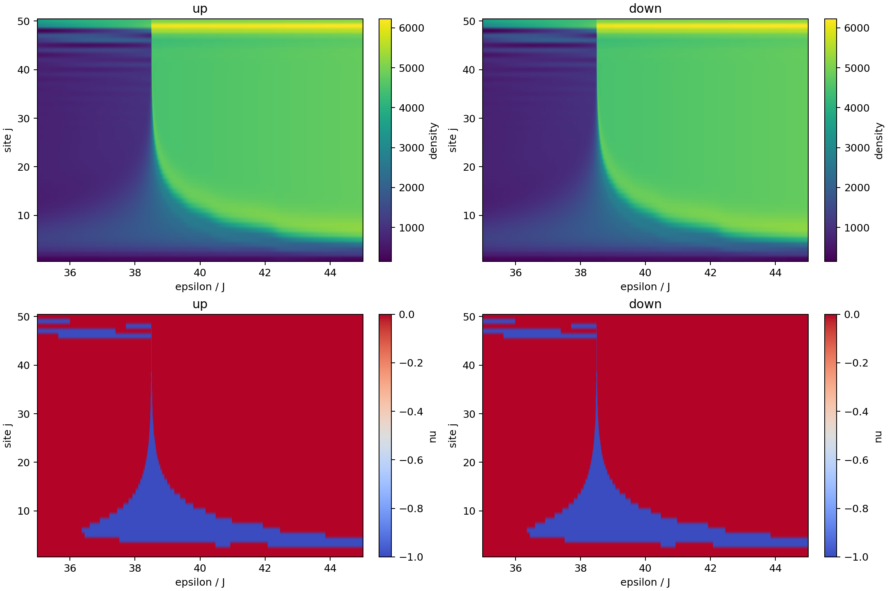

### Fixed compensated systems at epsilon=38.51

For each of the same three bulk roots, compensation is recomputed from that root's complex alpha0. Only the two endpoints are modified. The complete additive endpoint drives (including the real bulk drive 38.51) are:

|target|pump at site 1 / J|pump at site 50 / J|
|---|---|---|
|low|35.576410 -32.157513i|12.127572 +18.619320i|
|middle|42.707971 -44.417315i|-2.055509 +18.573108i|
|high|105.336044 -0.217739i|4.908411 -57.764182i|

All interior additive drives remain 38.51. These are three different fixed Hamiltonians. At s=1 their respective uniform profiles satisfy the stationary equations with residual below 1e-10. Independent banded characteristic-polynomial/Routh counts at 100 and 160 digits find zero growing modes for each target. No covariance dynamics or fluctuation feedback is included.

### Direct evolution from zero photons

For each fixed compensated Hamiltonian separately, set **alpha_j(0)=0 at every site** and switch on the complete constant drives at t=0. There is no compensation ramp, target seeding, feedback, or intermediate root solve during this evolution. Integrate with DOP853 to t=1200 (rtol=2e-10, atol=2e-11). Repeat independently from vacuum to t=2400 with rtol=2e-12, atol=2e-13.

After integration only, root polish the endpoint to identify the approached stationary solution. A state is classified as stationary only if the polished residual is below 1e-8, the raw endpoint force is below 1e-3, and the maximum complex amplitude distance between the integration endpoint and polished root is below 1e-3. The target is reached only if, additionally, max_j|alpha_j-alpha0|<1e-3. Therefore a solver finding the desired root cannot substitute for actual dynamical convergence to it.

|target|uniform density|target BdG growth / J|vacuum reaches target, t=1200|vacuum reaches target, tighter t=2400|small perturbation returns to target|
|---|---:|---:|---|---|---|
|low|1042.712|-0.131214|yes|yes|yes|
|middle|1990.521|-0.057127|NO|NO|yes|
|high|4465.768|-0.500000|yes|yes|yes|

The local-attraction check starts at alpha0 plus a complex random perturbation of scale 1e-4 per real/imaginary component, seed 20261104, and evolves under the same fixed drives to t=1200. All three return to the target. This tests one small perturbation, not an entire basin.

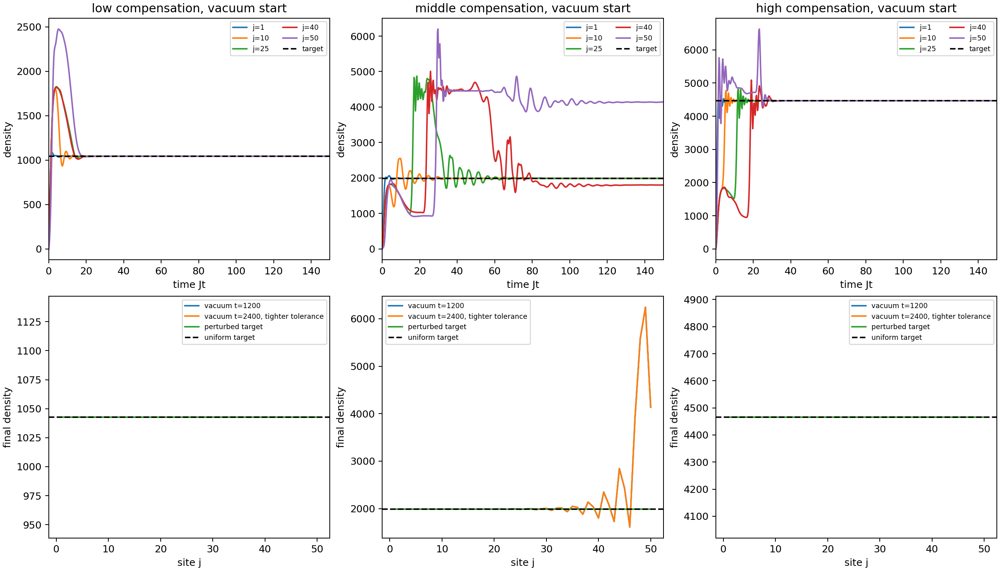

For the intermediate compensation, vacuum instead approaches a stable **inhomogeneous** stationary state: mean density 2250.115, site-density range 1610.733-6243.447, growth -0.060236 J. Its maximum complex amplitude difference from the uniform target is 102.610. The tighter, longer vacuum run reaches the same density profile to 3.84e-09 maximum site-density difference. Its final raw force is 2.55e-10, and the maximum temporal density standard deviation in the last 50 time units is 1.55e-07. Thus this failure to reach the intermediate target is not just incomplete relaxation at t=1200 or a loose integration tolerance.

The intermediate compensated system consequently supports **at least two distinct stable stationary states** in this mean-field calculation: the uniform target recovered from a nearby initial condition, and the inhomogeneous attractor reached from vacuum. Compensation stabilizes the target locally, but does not force vacuum to select it. We have not established whether a suitably designed preparation ramp could reach the intermediate target from vacuum; the negative result applies to the specified constant-drive switch-on protocol.

### Repeat removal of compensation at N=50

We also repeat local stationary continuation from s=1 toward zero for each root, plus the earlier s=1,0.98,...,0 staircase dynamics initialized at its uniform target. This preparation is deliberately distinguished from the direct-vacuum test above.

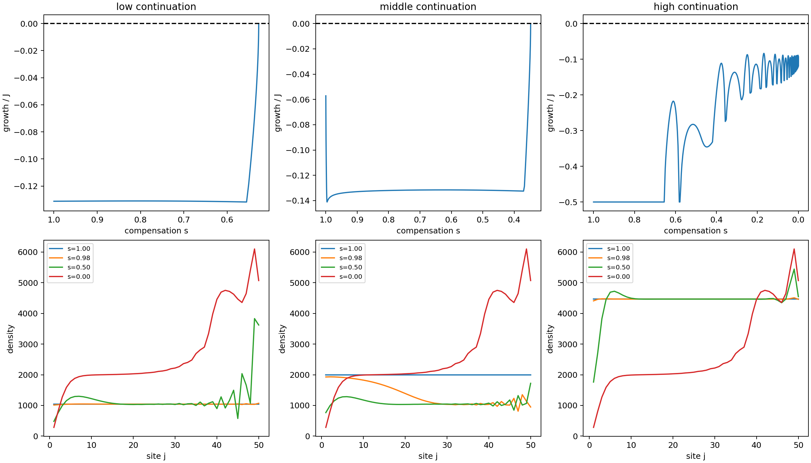

Local continuation reaches s=0.526985172 from the low root, s=0.347467297 from the intermediate root, and s=0.000000000 from the high root. The high branch reaches zero compensation. The other branches terminate numerically near marginal growth; these are not certified folds without pseudo-arclength continuation. Stationary continuation does not use a time-evolution fallback to jump to another branch.

### Reproduction, records, and limits

```powershell
python src/compensation_n50_vacuum.py
python src/report_compensation_n50.py
```

Driver: src/compensation_n50_vacuum.py. Generated data: data/generated/compensation_n50/scan_35_45.json and compensation.json. Records include target amplitudes and endpoint drives, BdG and high-precision counts, full vacuum trajectories, tighter-run trajectories, perturbed-target trajectories, raw endpoint force, root distance, final temporal variation, local continuation and failed attempts, and staircase profiles. Session interpreter is C:/Users/diego/miniconda3/envs/topo/python.exe.

Root tolerance is 1e-10, residual acceptance 1e-8. Stability tolerance is 1e-7 J. Local compensation continuation uses secant prediction, maximum step 0.005, step halving after failed roots or maximum amplitude changes above 1; minimum step is 1e-12, initial intermediate step 1e-7. The baseline scan uses the same mean-field-only evolution fallback as before. The sharper near-marginal continuation endpoints are numerical observations, not high-precision phase boundaries. This experiment concerns N=50 at epsilon=38.51; it does not assert vacuum reachability for every drive or chain length.

## N=50: add compensation after uncompensated relaxation

At epsilon=38.51 we now test the proposed two-stage preparation, rather than applying compensation directly to vacuum. All model parameters remain as in the preceding N=50 calculation.

1. Start at alpha_j=0 and evolve the uniformly driven **uncompensated** OBC chain to t=1200.
2. Verify that this raw dynamical endpoint is stationary, then use precisely that same complex profile as the initial condition in three separate experiments.
3. Abruptly add the fixed low-, intermediate-, or high-root endpoint compensation, keep all drives constant thereafter, and evolve for another 1200 time units.
4. Repeat the entire two-stage experiment independently with 2400 time units per stage and tighter tolerances.

No target state is seeded and no root-polished state replaces the dynamical endpoint at the switch. Root solving is only a final diagnostic. Compensation changes only the endpoint drive amplitudes/phases; it does not change detuning, hopping, loss, or interior drive.

The first stage reaches a stable inhomogeneous stationary state with mean density 2704.201, growth -0.093609 J and raw endpoint force 1.81e-08. The two preparation runs agree in their final site densities to 5.21e-10.

|compensation target|target uniform density|uniform target reached, 1200 per stage|target reached, tighter 2400 per stage|max complex amplitude error from target, 1200|final-state growth / J|
|---|---:|---|---|---:|---:|
|low|1042.712|yes|yes|1.48e-09|-0.131214|
|middle|1990.521|NO|NO|102.6|-0.060236|
|high|4465.768|yes|yes|4.707e-10|-0.500000|

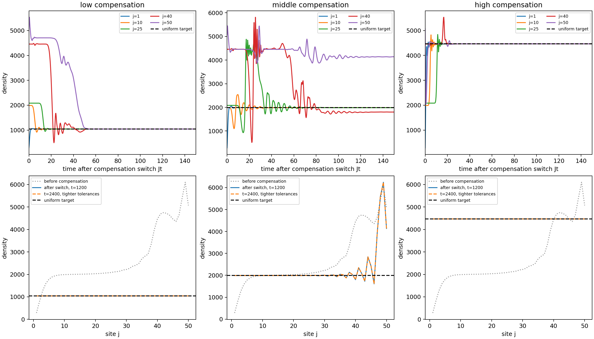

The intermediate compensation ends with mean density 2250.115, range 1610.733-6243.447. Its density difference from the inhomogeneous attractor obtained by applying intermediate compensation directly to vacuum in the preceding experiment is 3.8e-09. The tighter second-stage run has raw final force 2.55e-10, maximum amplitude distance to the root-polished endpoint 3.38e-10, and maximum density standard deviation over its last 50 time units 1.34e-07.

The results distinguish the basin reached by this protocol from local linear stability of the uniform targets. Failure of the intermediate target to be reached here would not contradict its verified local stability, nor rule out other preparation paths. Successful targets are identified by complex amplitude, not density alone: max_j|alpha_j-alpha0|<1e-3, in addition to the stationarity checks described above.

The base runs use DOP853 with rtol=2e-10, atol=2e-11; the independent longer runs use rtol=2e-12, atol=2e-13. Raw trajectories, initial preparation, final-state diagnostics and target errors are stored in data/generated/compensation_n50/after_relaxation.json. Reproduce with `python src/compensation_after_relaxation.py` from the project root. This session used C:/Users/diego/miniconda3/envs/topo/python.exe. No Gaussian covariance equations are evolved.

## N=50: smooth turn-on of the topological-root compensation

**Slow smooth switching reaches the uniform topological target in the tested N=50 chain.** Ramps with T=1000/J and 10000/J succeed, while T=10/J and 100/J reach the competing inhomogeneous state. This demonstrates a preparation from vacuum via initial uncompensated relaxation and slow endpoint switching, rather than initialization near the target.

We test whether slower switching reaches the uniform intermediate/topological root at epsilon=38.51. The initial state is the raw endpoint of the independently verified uncompensated vacuum evolution to t=2400, not a prepared uniform target. Only endpoint compensation changes; all bulk parameters and drives remain fixed.

For 0<=t<=T use s(t)=3(t/T)^2-2(t/T)^3, with zero slope at each endpoint. The endpoint drives follow the earlier intermediate-root compensation formula. After the ramp, hold s=1 for another 1200 time units and test stationarity and complex-amplitude agreement with the uniform target using the same thresholds as above.

|ramp duration T (1/J)|uniform topological target reached?|final mean density|max amplitude error from target|final-state growth / J|
|---:|---|---:|---:|---:|
|10|NO|2250.115|102.61|-0.060236|
|100|NO|2250.115|102.61|-0.060236|
|1000|yes|1990.521|1.4551e-09|-0.057127|
|10000|yes|1990.521|1.2672e-09|-0.057127|

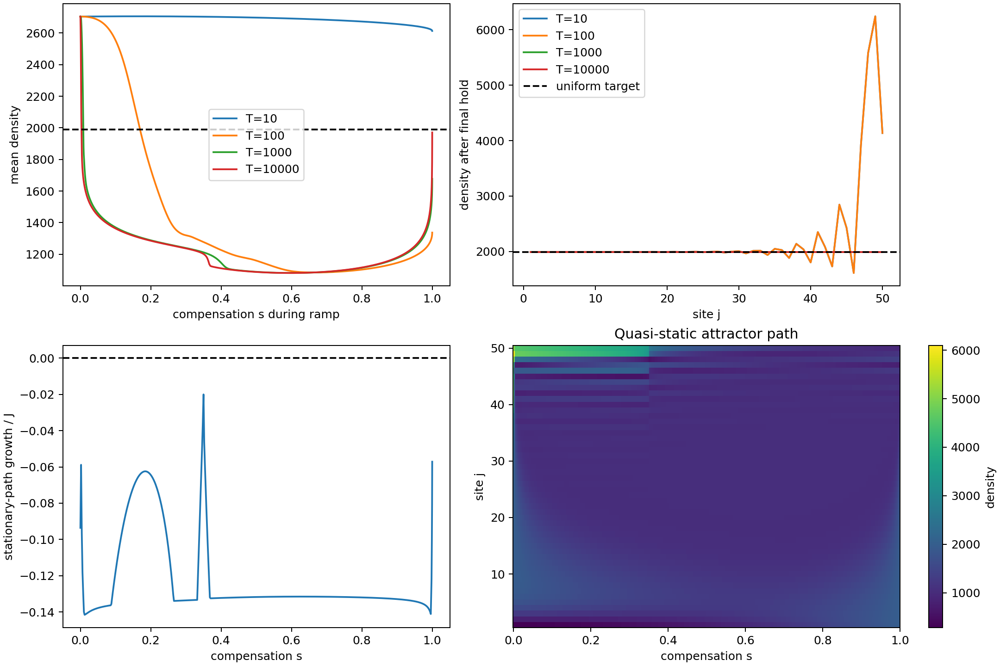

The slowest ramp was repeated with rtol=2e-12, atol=2e-13 instead of 2e-10, 2e-11. Its final density profile differs by 4.86e-10; target reached in that check: True. The tight final raw force is 2.15e-10; maximum last-50-time density standard deviation is 2.05e-08.

We separately follow a stationary attractor from s=0 to 1 on a 0.002 grid, with logarithmically refined steps in 1-s from 0.002 down to 1e-12 near the final endpoint, beginning with the same relaxed profile. Each step uses an analytic-Jacobian stationary root solve; if the solve fails or returns an unstable state, a mean-field evolution fallback supplies a new attractor seed. These possible switches are explicitly recorded and this procedure is not pseudo-arclength continuation. There are 3 such fallback steps. The maximum computed growth on the accepted path is -0.020032 J, and the final maximum density difference from the uniform target is 1.93922e-08. This numerical branch-tracking diagnostic can select a different basin from the continuous time-dependent ramp; it is not an independent simulation of the adiabatic limit.

These finite ramps and the quasi-static path test whether simple slow addition of the fixed endpoint compensation enters the desired basin. They do not prove a universal adiabatic limit or exclude other drive paths. A stable final target need not be the continuation of the attractor occupied initially. If the path remains on another stable branch, increasing ramp duration need not select the uniform target.

Reproduce with `python src/adiabatic_compensation_n50.py`. Full ramp trajectories, post-ramp holds, tolerance check, stationary-path profiles, growth and fallback records are saved in data/generated/compensation_n50/adiabatic_compensation.json. The same DOP853 mean-field evolution, root residual acceptance 1e-8, and stability threshold 1e-7 J apply. No covariance evolution is used.

## Complete preparation scan: epsilon=30 to 40, N=50

This consolidated section supersedes the earlier drive-scan discussions. **The full vacuum-relaxation plus compensation-ramp protocol has now been tested below 35 wherever a separate intermediate root exists**, not merely its stationary stability. Existence, OBC stability, topology, and preparation success remain distinct quantities.

### Root existence and the meaning of drives below 30.16063

The uniform cubic is epsilon^2=n[(c+u n)^2+gamma^2], c=1.4998, u=-0.0004, gamma=0.5. Its turning points satisfy 3u^2n^2+4cu n+c^2+gamma^2=0, giving

**30.16063463<epsilon<39.87065987**

for three distinct positive bulk roots. The intermediate/high roots merge at the lower endpoint, density 3520.083262; the intermediate/low roots merge at the upper endpoint, density 1479.250071. Root-specific endpoint compensation makes each existing bulk root an exact uniform OBC stationary solution, including endpoints. At or beyond a root merger there is no separate intermediate target to prepare.

For epsilon=30 to the lower turning point, the intermediate-root compensation is therefore undefined. Such points are marked **no intermediate target**, not failed ramp simulations; a low-density stationary solution still exists. Cubic roots were explicitly evaluated at every requested coarse drive, including those below the existence boundary. There are 10 sampled drives without three distinct roots. No arbitrary continuation of endpoint compensation past the root merger is introduced.

### Protocol and coverage

N=50, J=1, U=-0.0002 with U n^2 normal ordering retained, V=0, Delta=0.5, kappa=1, phi=pi/3. Drive is real and uniform in the bulk. For each drive independently, start with alpha_j=0; evolve without compensation for 1200/J. Then add fixed target-specific endpoint fields with s(t)=3(t/T)^2-2(t/T)^3, testing T=1000/J and 10000/J. Hold s=1 for another 1200/J. Endpoint additive pumps are epsilon+s J exp(+i phi) alpha0 and epsilon+s J exp(-i phi) alpha0. No root-polished state is substituted during preparation.

The combined scan covers 30-40 on a 0.05 grid, retains the prior fine central and outcome-transition samples, and adds lower-edge drives 30.1607,30.161,30.162,30.165,30.17,30.18,30.19. Coarse brackets with a change of either ramp outcome or root existence are refined to 0.01. There are 233 sampled drives, 223 with an intermediate target; 103 eligible points below 35 have now received both full ramp tests. All uncompensated vacuum-preparation endpoints pass the existing stationary criterion: True.

### Preparation results

Spans below describe consecutive **sampled** points with the same outcome, not certified continuum windows or globally optimal preparation limits. Both the density and complex phase are checked, including the end sites.

|ramp time T (1/J)|sampled drive span|sample count|uniform intermediate target reached?|
|---:|---|---:|---|
|1000|30.160700-39.610000|213|yes|
|1000|39.620000-39.870000|10|NO|
|10000|30.160700-39.610000|213|yes|
|10000|39.620000-39.870000|10|NO|

Both ramp times succeed at every sampled eligible drive below 35, including epsilon=30.1607. No lower preparation-failure boundary is observed before the intermediate root ceases to exist. This is numerical evidence down to the nearest tested point, not proof of success arbitrarily close to or exactly at the merger. The previously observed upper preparation change between 39.61 and 39.62 persists and remains distinct from the upper root-existence boundary.

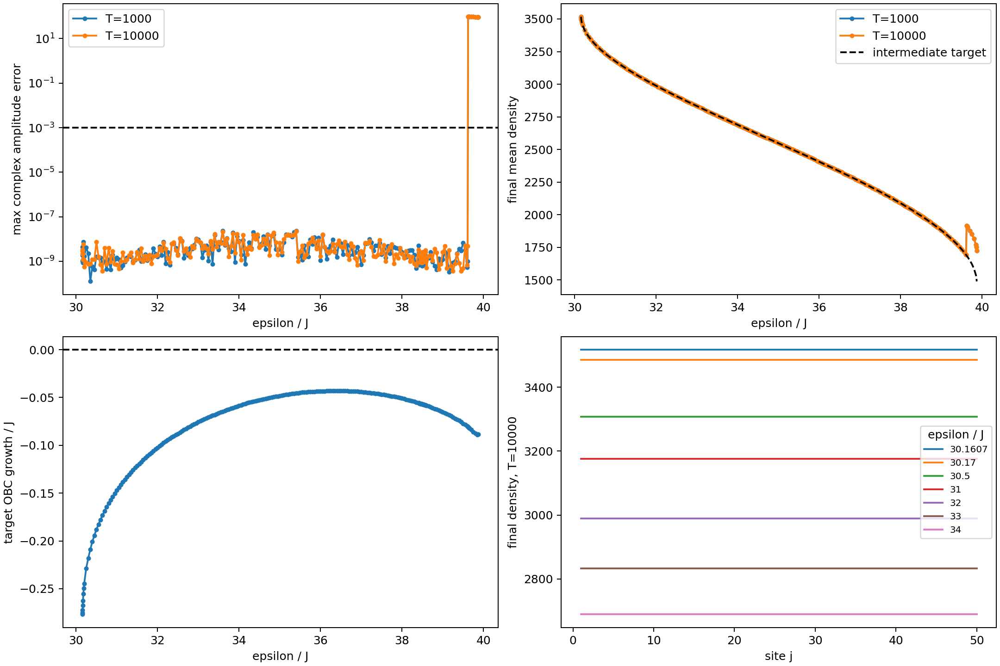

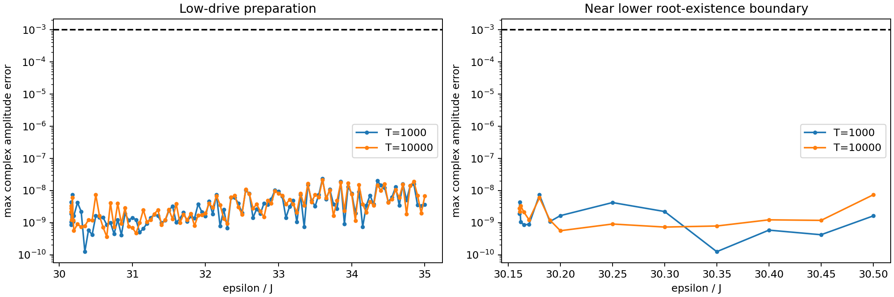

The largest uniform-target growth over eligible drives is -0.042942 J. Sampled zero-frequency winding labels are [-1]. These characterize the existing uniform targets, independently of which attractor the ramp reaches. Failed preparation is not evidence that the target is absent or unstable; compare final-state force, root distance, temporal variation, and BdG growth in the saved records. The analytical lower existence boundary is distinct from any finite-time preparation boundary apparent in the outcome table.

### Convergence and independent checks

Base dynamics uses DOP853, rtol=2e-10, atol=2e-11. Target success requires a raw endpoint force below 1e-3, maximum complex amplitude distance below 1e-3 from a stationary root accepted with max|f|<1e-8, and max_j|alpha_j-alpha0|<1e-3. Analytic-Jacobian root tolerance is 1e-10. Eigenmodes evolve as exp(-i omega t); positive Im(omega) means growth, with stability classification tolerance 1e-7 J.

Independent repeats use a fresh vacuum initial condition, 2400/J uncompensated preparation, and tighter rtol=2e-12, atol=2e-13; both ramp times and the 1200/J final hold are retained. Selected low drives include 30.1607,30.17,31,32,33,34 and both sides of each observed low-drive change in outcome. Existing upper-drive checks are retained. Tight outcomes (T=1000/T=10000): 30.160700: yes/yes; 30.170000: yes/yes; 31.000000: yes/yes; 32.000000: yes/yes; 33.000000: yes/yes; 34.000000: yes/yes; 35.000000: yes/yes; 37.000000: yes/yes; 38.510000: yes/yes; 39.610000: yes/yes; 39.620000: NO/NO.

For these selected uniform targets, characteristic-polynomial/Routh root counts at 100 and 160 decimal digits check the number of growing modes. These and double-precision residuals are numerical evidence, not interval certificates. Near a saddle-node, distinct densities and required preparation precision can become small; the nearest tested drive is 30.1607, above the analytical boundary by about 6.54e-5. No ramp was attempted at the exact merger. Finite ramp tests do not establish an asymptotic adiabatic limit, global uniqueness, or the full basin geometry.

### All eligible sampled drives

|epsilon / J|intermediate target density|target OBC growth / J|zero-frequency winding|T=1000 target reached?|T=10000 target reached?|
|---:|---:|---:|---:|---|---|
|30.160700|3517.245|-0.276829|-1|yes|yes|
|30.161000|3513.368|-0.274968|-1|yes|yes|
|30.162000|3507.088|-0.272075|-1|yes|yes|
|30.165000|3496.807|-0.267544|-1|yes|yes|
|30.170000|3485.928|-0.262726|-1|yes|yes|
|30.180000|3470.842|-0.255223|-1|yes|yes|
|30.190000|3459.325|-0.249449|-1|yes|yes|
|30.200000|3449.617|-0.244650|-1|yes|yes|
|30.250000|3413.215|-0.228581|-1|yes|yes|
|30.300000|3385.951|-0.218007|-1|yes|yes|
|30.350000|3363.050|-0.208901|-1|yes|yes|
|30.400000|3342.841|-0.200867|-1|yes|yes|
|30.450000|3324.503|-0.194250|-1|yes|yes|
|30.500000|3307.562|-0.188117|-1|yes|yes|
|30.550000|3291.714|-0.182741|-1|yes|yes|
|30.600000|3276.751|-0.177859|-1|yes|yes|
|30.650000|3262.521|-0.173235|-1|yes|yes|
|30.700000|3248.913|-0.168767|-1|yes|yes|
|30.750000|3235.840|-0.164504|-1|yes|yes|
|30.800000|3223.232|-0.160555|-1|yes|yes|
|30.850000|3211.034|-0.156996|-1|yes|yes|
|30.900000|3199.201|-0.153784|-1|yes|yes|
|30.950000|3187.694|-0.150363|-1|yes|yes|
|31.000000|3176.482|-0.147162|-1|yes|yes|
|31.050000|3165.537|-0.144141|-1|yes|yes|
|31.100000|3154.835|-0.141252|-1|yes|yes|
|31.150000|3144.357|-0.138454|-1|yes|yes|
|31.200000|3134.084|-0.135717|-1|yes|yes|
|31.250000|3124.000|-0.133035|-1|yes|yes|
|31.300000|3114.092|-0.130424|-1|yes|yes|
|31.350000|3104.347|-0.127911|-1|yes|yes|
|31.400000|3094.754|-0.125526|-1|yes|yes|
|31.450000|3085.303|-0.123290|-1|yes|yes|
|31.500000|3075.985|-0.121209|-1|yes|yes|
|31.550000|3066.791|-0.119276|-1|yes|yes|
|31.600000|3057.715|-0.117298|-1|yes|yes|
|31.650000|3048.748|-0.115216|-1|yes|yes|
|31.700000|3039.886|-0.113218|-1|yes|yes|
|31.750000|3031.122|-0.111290|-1|yes|yes|
|31.800000|3022.450|-0.109418|-1|yes|yes|
|31.850000|3013.866|-0.107587|-1|yes|yes|
|31.900000|3005.366|-0.105788|-1|yes|yes|
|31.950000|2996.944|-0.104014|-1|yes|yes|
|32.000000|2988.597|-0.102268|-1|yes|yes|
|32.050000|2980.322|-0.100555|-1|yes|yes|
|32.100000|2972.114|-0.098886|-1|yes|yes|
|32.150000|2963.971|-0.097274|-1|yes|yes|
|32.200000|2955.889|-0.095731|-1|yes|yes|
|32.250000|2947.866|-0.094265|-1|yes|yes|
|32.300000|2939.898|-0.092879|-1|yes|yes|
|32.350000|2931.984|-0.091573|-1|yes|yes|
|32.400000|2924.120|-0.090339|-1|yes|yes|
|32.450000|2916.305|-0.089145|-1|yes|yes|
|32.500000|2908.536|-0.087759|-1|yes|yes|
|32.550000|2900.812|-0.086421|-1|yes|yes|
|32.600000|2893.130|-0.085124|-1|yes|yes|
|32.650000|2885.488|-0.083861|-1|yes|yes|
|32.700000|2877.884|-0.082627|-1|yes|yes|
|32.750000|2870.318|-0.081413|-1|yes|yes|
|32.800000|2862.787|-0.080216|-1|yes|yes|
|32.850000|2855.289|-0.079033|-1|yes|yes|
|32.900000|2847.824|-0.077865|-1|yes|yes|
|32.950000|2840.389|-0.076713|-1|yes|yes|
|33.000000|2832.983|-0.075584|-1|yes|yes|
|33.050000|2825.606|-0.074484|-1|yes|yes|
|33.100000|2818.255|-0.073421|-1|yes|yes|
|33.150000|2810.930|-0.072401|-1|yes|yes|
|33.200000|2803.628|-0.071431|-1|yes|yes|
|33.250000|2796.350|-0.070513|-1|yes|yes|
|33.300000|2789.094|-0.069649|-1|yes|yes|
|33.350000|2781.859|-0.068837|-1|yes|yes|
|33.400000|2774.643|-0.068071|-1|yes|yes|
|33.450000|2767.447|-0.067250|-1|yes|yes|
|33.500000|2760.268|-0.066347|-1|yes|yes|
|33.550000|2753.106|-0.065477|-1|yes|yes|
|33.600000|2745.959|-0.064637|-1|yes|yes|
|33.650000|2738.828|-0.063822|-1|yes|yes|
|33.700000|2731.711|-0.063028|-1|yes|yes|
|33.750000|2724.607|-0.062250|-1|yes|yes|
|33.800000|2717.516|-0.061484|-1|yes|yes|
|33.850000|2710.436|-0.060727|-1|yes|yes|
|33.900000|2703.366|-0.059979|-1|yes|yes|
|33.950000|2696.307|-0.059238|-1|yes|yes|
|34.000000|2689.257|-0.058509|-1|yes|yes|
|34.050000|2682.215|-0.057795|-1|yes|yes|
|34.100000|2675.180|-0.057101|-1|yes|yes|
|34.150000|2668.153|-0.056433|-1|yes|yes|
|34.200000|2661.132|-0.055797|-1|yes|yes|
|34.250000|2654.116|-0.055198|-1|yes|yes|
|34.300000|2647.105|-0.054641|-1|yes|yes|
|34.350000|2640.097|-0.054128|-1|yes|yes|
|34.400000|2633.094|-0.053659|-1|yes|yes|
|34.450000|2626.092|-0.053190|-1|yes|yes|
|34.500000|2619.093|-0.052615|-1|yes|yes|
|34.550000|2612.095|-0.052071|-1|yes|yes|
|34.600000|2605.097|-0.051558|-1|yes|yes|
|34.650000|2598.100|-0.051073|-1|yes|yes|
|34.700000|2591.101|-0.050615|-1|yes|yes|
|34.750000|2584.101|-0.050179|-1|yes|yes|
|34.800000|2577.100|-0.049761|-1|yes|yes|
|34.850000|2570.095|-0.049357|-1|yes|yes|
|34.900000|2563.087|-0.048963|-1|yes|yes|
|34.950000|2556.075|-0.048576|-1|yes|yes|
|35.000000|2549.058|-0.048193|-1|yes|yes|
|35.050000|2542.036|-0.047814|-1|yes|yes|
|35.100000|2535.008|-0.047442|-1|yes|yes|
|35.150000|2527.974|-0.047078|-1|yes|yes|
|35.200000|2520.932|-0.046728|-1|yes|yes|
|35.250000|2513.882|-0.046398|-1|yes|yes|
|35.300000|2506.823|-0.046094|-1|yes|yes|
|35.350000|2499.755|-0.045823|-1|yes|yes|
|35.400000|2492.677|-0.045540|-1|yes|yes|
|35.450000|2485.589|-0.045218|-1|yes|yes|
|35.500000|2478.489|-0.044922|-1|yes|yes|
|35.550000|2471.377|-0.044656|-1|yes|yes|
|35.600000|2464.252|-0.044422|-1|yes|yes|
|35.650000|2457.113|-0.044221|-1|yes|yes|
|35.700000|2449.961|-0.044053|-1|yes|yes|
|35.750000|2442.793|-0.043918|-1|yes|yes|
|35.800000|2435.610|-0.043813|-1|yes|yes|
|35.850000|2428.411|-0.043736|-1|yes|yes|
|35.900000|2421.194|-0.043682|-1|yes|yes|
|35.950000|2413.959|-0.043646|-1|yes|yes|
|36.000000|2406.706|-0.043578|-1|yes|yes|
|36.050000|2399.433|-0.043433|-1|yes|yes|
|36.100000|2392.139|-0.043311|-1|yes|yes|
|36.150000|2384.824|-0.043209|-1|yes|yes|
|36.200000|2377.488|-0.043126|-1|yes|yes|
|36.250000|2370.128|-0.043059|-1|yes|yes|
|36.300000|2362.744|-0.043006|-1|yes|yes|
|36.350000|2355.335|-0.042969|-1|yes|yes|
|36.400000|2347.901|-0.042947|-1|yes|yes|
|36.450000|2340.440|-0.042942|-1|yes|yes|
|36.500000|2332.951|-0.042958|-1|yes|yes|
|36.550000|2325.433|-0.043000|-1|yes|yes|
|36.600000|2317.885|-0.043071|-1|yes|yes|
|36.650000|2310.307|-0.043177|-1|yes|yes|
|36.700000|2302.696|-0.043322|-1|yes|yes|
|36.750000|2295.052|-0.043407|-1|yes|yes|
|36.800000|2287.373|-0.043459|-1|yes|yes|
|36.850000|2279.659|-0.043546|-1|yes|yes|
|36.900000|2271.908|-0.043669|-1|yes|yes|
|36.950000|2264.119|-0.043831|-1|yes|yes|
|37.000000|2256.290|-0.044032|-1|yes|yes|
|37.050000|2248.419|-0.044271|-1|yes|yes|
|37.100000|2240.506|-0.044547|-1|yes|yes|
|37.150000|2232.549|-0.044856|-1|yes|yes|
|37.200000|2224.546|-0.045172|-1|yes|yes|
|37.250000|2216.496|-0.045348|-1|yes|yes|
|37.300000|2208.396|-0.045560|-1|yes|yes|
|37.350000|2200.245|-0.045806|-1|yes|yes|
|37.400000|2192.041|-0.046085|-1|yes|yes|
|37.450000|2183.782|-0.046394|-1|yes|yes|
|37.500000|2175.466|-0.046731|-1|yes|yes|
|37.550000|2167.091|-0.047094|-1|yes|yes|
|37.600000|2158.654|-0.047485|-1|yes|yes|
|37.650000|2150.152|-0.047904|-1|yes|yes|
|37.700000|2141.584|-0.048357|-1|yes|yes|
|37.750000|2132.947|-0.048681|-1|yes|yes|
|37.800000|2124.237|-0.049027|-1|yes|yes|
|37.850000|2115.452|-0.049412|-1|yes|yes|
|37.900000|2106.588|-0.049841|-1|yes|yes|
|37.950000|2097.642|-0.050318|-1|yes|yes|
|38.000000|2088.610|-0.050849|-1|yes|yes|
|38.050000|2079.489|-0.051439|-1|yes|yes|
|38.100000|2070.274|-0.052093|-1|yes|yes|
|38.150000|2060.960|-0.052539|-1|yes|yes|
|38.200000|2051.544|-0.053024|-1|yes|yes|
|38.250000|2042.020|-0.053575|-1|yes|yes|
|38.300000|2032.382|-0.054196|-1|yes|yes|
|38.350000|2022.625|-0.054888|-1|yes|yes|
|38.400000|2012.742|-0.055650|-1|yes|yes|
|38.410000|2010.750|-0.055811|-1|yes|yes|
|38.420000|2008.752|-0.055975|-1|yes|yes|
|38.430000|2006.749|-0.056141|-1|yes|yes|
|38.440000|2004.740|-0.056310|-1|yes|yes|
|38.450000|2002.726|-0.056461|-1|yes|yes|
|38.460000|2000.706|-0.056564|-1|yes|yes|
|38.470000|1998.681|-0.056670|-1|yes|yes|
|38.480000|1996.650|-0.056779|-1|yes|yes|
|38.490000|1994.613|-0.056892|-1|yes|yes|
|38.500000|1992.570|-0.057008|-1|yes|yes|
|38.510000|1990.521|-0.057127|-1|yes|yes|
|38.520000|1988.466|-0.057249|-1|yes|yes|
|38.530000|1986.405|-0.057375|-1|yes|yes|
|38.540000|1984.338|-0.057504|-1|yes|yes|
|38.550000|1982.265|-0.057636|-1|yes|yes|
|38.560000|1980.185|-0.057771|-1|yes|yes|
|38.570000|1978.099|-0.057910|-1|yes|yes|
|38.580000|1976.006|-0.058052|-1|yes|yes|
|38.590000|1973.907|-0.058196|-1|yes|yes|
|38.600000|1971.802|-0.058345|-1|yes|yes|
|38.650000|1961.171|-0.059132|-1|yes|yes|
|38.700000|1950.362|-0.059994|-1|yes|yes|
|38.750000|1939.362|-0.060929|-1|yes|yes|
|38.800000|1928.158|-0.061764|-1|yes|yes|
|38.850000|1916.734|-0.062477|-1|yes|yes|
|38.900000|1905.074|-0.063284|-1|yes|yes|
|38.950000|1893.159|-0.064190|-1|yes|yes|
|39.000000|1880.966|-0.065206|-1|yes|yes|
|39.050000|1868.471|-0.066351|-1|yes|yes|
|39.100000|1855.645|-0.067293|-1|yes|yes|
|39.150000|1842.454|-0.068154|-1|yes|yes|
|39.200000|1828.859|-0.069183|-1|yes|yes|
|39.250000|1814.813|-0.070419|-1|yes|yes|
|39.300000|1800.258|-0.071904|-1|yes|yes|
|39.350000|1785.127|-0.072834|-1|yes|yes|
|39.400000|1769.330|-0.073952|-1|yes|yes|
|39.450000|1752.760|-0.075438|-1|yes|yes|
|39.500000|1735.270|-0.077305|-1|yes|yes|
|39.550000|1716.666|-0.078274|-1|yes|yes|
|39.600000|1696.672|-0.079900|-1|yes|yes|
|39.610000|1692.474|-0.080305|-1|yes|yes|
|39.620000|1688.200|-0.080732|-1|NO|NO|
|39.630000|1683.847|-0.081179|-1|NO|NO|
|39.640000|1679.408|-0.081641|-1|NO|NO|
|39.650000|1674.879|-0.082114|-1|NO|NO|
|39.700000|1650.623|-0.083429|-1|NO|NO|
|39.750000|1622.702|-0.085935|-1|NO|NO|
|39.800000|1588.422|-0.087341|-1|NO|NO|
|39.850000|1537.801|-0.089163|-1|NO|NO|
|39.860000|1521.195|-0.088663|-1|NO|NO|
|39.870000|1489.632|-0.088248|-1|NO|NO|

Reproduce the extension with `python src/scan_preparation_30_35.py`. Per-drive low records and tighter repeats are in data/generated/compensation_n50/preparation_30_35/; combined source paths are indexed by intermediate_preparation_30_40_index.json in the parent directory. The previous 35-40 dataset supplies unchanged upper-drive runs. All new low-drive preparations start independently from vacuum. Records retain actual ramp trajectories, final complex amplitudes, stationary profiles, force, root distances, tail variation, target/approached-state growth, and winding. No Gaussian covariance equations or fluctuation feedback enter these calculations.

## Compensated intermediate-state stability over 0 <= phi <= pi

This complete phase description replaces the earlier pi/3-to-zero discussion. Fix **epsilon=38.51 and N=50**, J=1, U=-0.0002, V=0, Delta=0.5, kappa=1. Scan phi from pi (180 degrees) down to zero. This is a stationary mean-field and OBC Bogoliubov calculation only: **no adiabatic ramp or time evolution is simulated**.

### Existence comes before stability

At each phi recompute the positive real roots of

`epsilon^2 = n [(c(phi)+2U n)^2+(kappa/2)^2]`,

`c(phi)=Delta+U+2J cos(phi)=0.4998+2 cos(phi)`.

The intermediate root means the middle density among **three positive real roots**. It exists only in

**18.22470181 < phi < 61.33834072 degrees**, or **0.3180810517 < phi < 1.0705560033 radians**.

At the higher-phase endpoint 61.33834072 degrees, the low- and intermediate-density roots merge. Thus, beginning at phi=pi and decreasing, there is initially only one positive bulk root, and a separate intermediate branch appears only below this endpoint. At the lower-phase endpoint 18.22470181 degrees, the intermediate and high roots merge; below it only one positive root remains again. At each merger two roots coincide, so the endpoint is not part of the distinct three-root interval.

These existence bounds are solved from the two bulk cubic turning points, not inferred from a failed numerical steady-state solver. With u=2U, they satisfy 3u^2 n^2+4c(phi)u n+c(phi)^2+(kappa/2)^2=0 together with the stationary cubic. Positivity and reality are checked explicitly on the full phase grid. For phi where c<=sqrt(3) kappa/2, positive-density bistability is impossible; in particular no intermediate branch reappears at larger phi up to pi. The remaining single-root solution is not absent and is not assessed here as an intermediate phase.

### Compensation and Bogoliubov conventions

Where the intermediate root exists, set alpha0=-epsilon/[c(phi)+2Un-i kappa/2] and recompute the fixed endpoint additive drives:

`pump_1=epsilon+J exp(+i phi) alpha0`,

`pump_N=epsilon+J exp(-i phi) alpha0`.

Interior drive stays epsilon. This makes the target exactly uniform, including both edge sites; the maximum stationary-force residual on the full scan is 5.28e-12. The paper's U n^2 convention, including the +U shift, is retained. The density, complex phase, pairing, and endpoint compensation vary with phi; this is not a frozen-background quadratic sweep.

The fixed drives add no BdG derivatives. The OBC matrix is L=[[A,B],[-B*,-A*]], with A=T+diag(Delta+U+4Un-i kappa/2), B=2U alpha0^2 I. Directed nearest-neighbour hopping is T[j+1,j]=J exp(+i phi), sites 1..50, and no closing bond. Modes evolve as exp(-i omega t); the maximum Im(omega) is the growth rate. Negative is stable, positive unstable, and magnitudes below 1e-7 J are marginal/unresolved.

### Complete result, read from pi downward

|phase interval (degrees)|compensated intermediate state|
|---|---|
|61.3383 < phi <= 180|no separate intermediate root|
|56.2397 < phi < 61.3383|stable|
|18.2898 < phi < 56.2397|unstable|
|18.2247 < phi < 18.2898|stable again, narrow interval|
|0 <= phi < 18.2247|no separate intermediate root|

Zero-growth crossings occur at 56.23966500 degrees and 18.28978185 degrees and are marginal. The compensated intermediate state therefore does **not** exist near phi=pi or phi=0, and existence must not be confused with stability. Where it exists, its OBC BdG operator changes from stable to unstable and back to stable as phi decreases. These are finite-N=50 stability intervals, not thermodynamic conclusions or claims about the other roots.

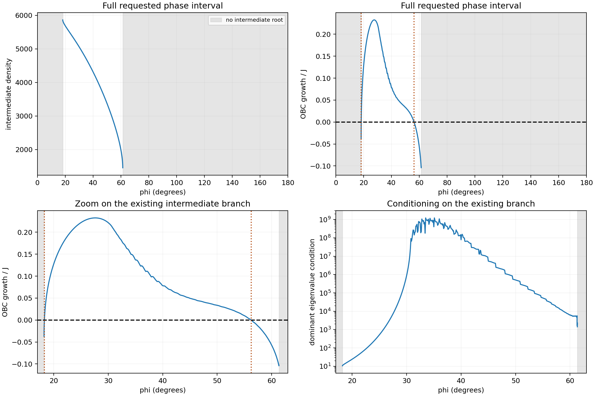

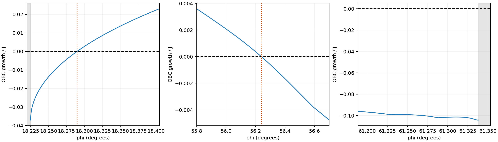

|phi (degrees)|intermediate density|OBC growth / J|classification|
|---:|---:|---:|---|
|180|--|--|no intermediate root|
|150|--|--|no intermediate root|
|120|--|--|no intermediate root|
|90|--|--|no intermediate root|
|75|--|--|no intermediate root|
|65|--|--|no intermediate root|
|62|--|--|no intermediate root|
|61.3|1534.939|-0.101490|stable|
|61|1706.854|-0.088037|stable|
|60|1990.521|-0.057127|stable|
|57|2516.337|-0.007674|stable|
|56|2658.271|0.002079|unstable|
|50|3375.634|0.033595|unstable|
|40|4314.265|0.078414|unstable|
|30|5061.063|0.221871|unstable|
|20|5690.299|0.127540|unstable|
|18.25|5849.209|-0.013717|stable|
|18|--|--|no intermediate root|
|0|--|--|no intermediate root|

### Numerical resolution and independent precision checks

The full grid has 0.1-degree spacing over 0-180 degrees. Extra phases approach both existence endpoints from inside by logarithmically spaced distances 1e-5 to 0.1 degrees, resolving the narrow low-phase stable interval. Spectral-growth sign changes are refined with a scalar zero finder. Full complex OBC spectra, dominant left/right eigenvector condition numbers, residuals and sensitivity indicators are saved. Strong nonnormality means last digits of double-precision eigenvalues need care; stability-crossing digits are numerical estimates rather than certified bounds.

For representative phases, a point 0.001 degrees below the high-phase root merger, a point 0.01 degrees above the low-phase merger, and both sides of each stability crossing offset by 0.001 degrees, the background density and trigonometric coefficients are recomputed at high precision. The real-quadrature generator's banded characteristic polynomial and Routh recursion count growing roots at 100 and 160 digits, also checking shifts +/-1e-7. The 160-digit zero-shift counts are:

|phi (degrees)|growing generator modes|
|---:|---:|
|61.337341|0|
|61.000000|0|
|60.000000|0|
|56.240665|0|
|56.238665|2|
|55.000000|12|
|40.000000|13|
|20.000000|3|
|18.290782|1|
|18.288782|0|
|18.234702|0|

Counts at both precisions are saved. They independently check stable/unstable labels at selected phases, not every continuum point, and are precision-convergence evidence rather than interval-arithmetic certificates. No stationary root is extrapolated beyond a branch merger. No preparation or basin-of-attraction conclusion is inferred from this stability-only calculation.

### Reproduction and records

Run `python src/compensated_phi_full_range.py`. The complete dataset is data/generated/compensation_n50/compensated_phi_full_range.json, with all positive real bulk roots, existence flags across 0..pi, the intermediate complex amplitude and both complex endpoint pumps where defined, full OBC spectra, residuals, growth, conditioning, refined crossings, analytical merger locations and precision counts. The earlier partial-range dataset is retained for provenance; its discussion has been replaced by this complete description. No Gaussian covariance evolution or fluctuation feedback is used.

## Two-dimensional map: compensation-stabilizable intermediate solutions

The requested map uses **epsilon on the horizontal axis and phi on the vertical axis**, retaining N=50, J=1, U=-0.0002, V=0, Delta=0.5 and kappa=1. Green means the intermediate bulk root exists and its **homogeneous OBC BdG operator is strictly stable**. The exact fixed endpoint compensation therefore constructs a locally stable homogeneous mean-field BHM solution there. Orange means an existing intermediate target is unstable; grey means no separate intermediate root; yellow marks growth magnitudes <=1e-7 J, numerically marginal/unresolved.

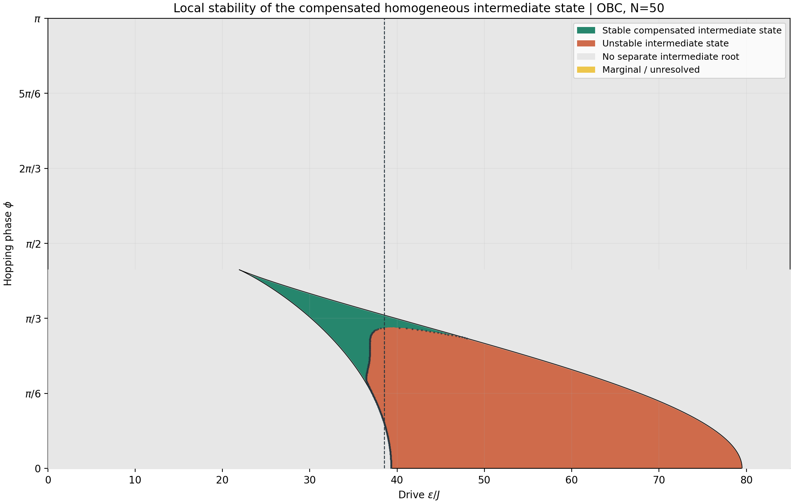

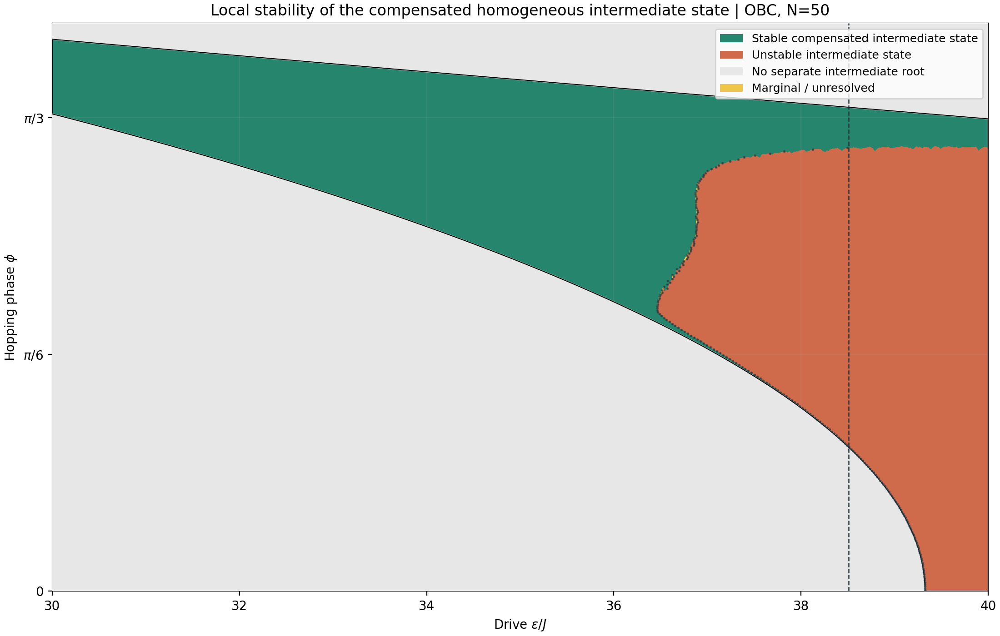

This is **not a map of successful adiabatic preparation or robustness to imperfect compensation**. Green establishes exact stationarity and local BdG stability with root-specific fixed drives. Vacuum/ramp reachability can be more restrictive, as the separate simulations above show. It does not imply three stable roots for one fixed endpoint-drive setting.

### Existence region and sampling

The intermediate density lies between the positive turning densities of the bulk cubic. With c(phi)=0.4998+2 cos(phi), u=-0.0004 and gamma=0.5, these solve 3u^2 n^2+4cu n+c^2+gamma^2=0. Positive-density bistability requires c>sqrt(3)gamma, restricting the existence lobe to phi<79.448881 degrees. The lobe starts at the cusp drive epsilon=21.93456688 and reaches upper drive epsilon=79.51348142 at phi=0, so the full axes 0<=epsilon<=85 and 0<=phi<=pi cover all possible three-positive-root solutions for these parameters.

We parameterize the intermediate branch directly by its density between the two turning points. There are 320 phase rows, uniformly spaced over the existence sector (spacing about 0.2483 degrees), and 91 nonuniform density fractions per row, with extra samples near both root mergers. Each density is converted to epsilon through the stationary cubic and gets its own OBC spectrum. This curved sampling avoids missing thin stable strips next to an existence curve, which a coarse rectangular epsilon grid could miss. The shading interpolates growth rates on a triangulation augmented with refined zero-growth points; the analytical existence curves mask the outside region. Black outer curves mark root-existence limits, dark internal points mark refined zero-growth boundaries, and the dashed vertical line is epsilon=38.51.

The calculation has 29120 stationary-background spectra: 12875 stable, 16245 unstable and 0 marginal samples. These sample counts are not physical parameter-space areas because the density grid is nonuniform. Root-existence boundaries are excluded as distinct intermediate solutions because roots coincide there. The phi=0 boundary is approached by the mesh and checked separately at selected densities.

### Stability and verification

At each point d=Delta+U+4Un and |g|=|2U|n define the uniform OBC operator. A global Nambu rotation removes the constant pairing phase without changing the spectrum. Modes evolve as exp(-i omega t), so max Im(omega)<0 is stable. Endpoint compensation is calculated from the complex homogeneous alpha0, not optimized: pump_1=epsilon+J exp(+i phi) alpha0, pump_N=epsilon+J exp(-i phi) alpha0. Fixed additive compensation contributes no BdG derivatives. No Gaussian covariance equations or feedback are used.

All zero-growth sign changes along each sampled density row are refined with a scalar root solve. Representative points at phi=0,20,40,60,75 degrees, with densities near both turning boundaries and in the middle, are independently checked by characteristic-polynomial/Routh counts at 100 and 160 digits. Their stable/unstable labels agree with both precisions, and the corresponding complex compensated mean-field residuals are below 1e-8. The earlier high-precision epsilon=38.51 phase-slice checks remain independent validation. Selected checks do not certify every colored cell; near boundaries the plot is a finite-resolution numerical map, not a rigorous continuum certificate. N is fixed at 50 and no infinite-chain stability conclusion is claimed.

Reproduce with `python src/compensated_stability_map.py`. Curved-grid densities, drives, phases and growth rates are saved in data/generated/compensation_n50/compensated_stability_map.npz; counts, refined boundary points, parameters and precision checks are in compensated_stability_map.json. Full and zoom figures are provided as PNG and vector PDF files under figures/.

## Two-dimensional compensation stability map repeated for N=20

This repeats the preceding N=50 calculation with **N=20**, keeping J=1, U=-0.0002, V=0, Delta=0.5, kappa=1 and exactly the same epsilon/phi backgrounds and sampling. The axes are epsilon horizontally and phi vertically. Green denotes an existing intermediate homogeneous root whose **N=20 OBC BdG operator is stable**, orange an unstable target, grey no distinct intermediate root, and yellow marginal/unresolved growth within 1e-7 J.

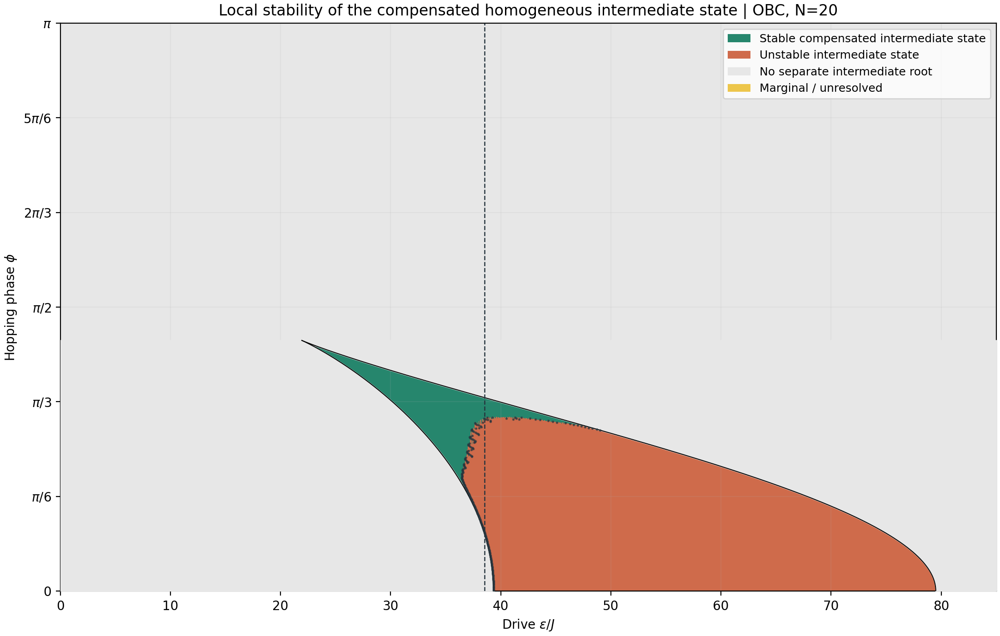

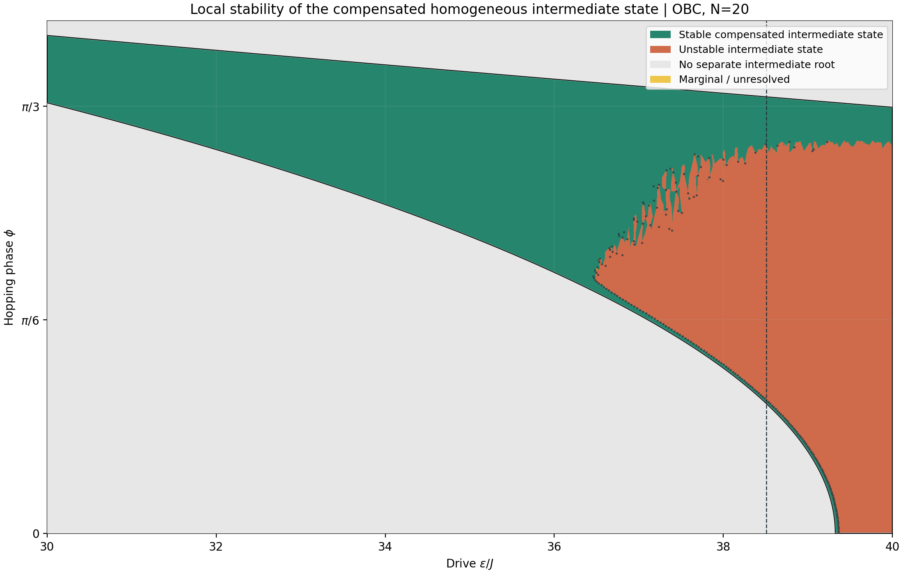

### What changes with chain length

The root-existence lobe and root-specific compensation formula are unchanged: they depend on the uniform bulk cubic, not chain length. Every density and complex homogeneous background is therefore the same as in the N=50 calculation. Only the OBC BdG operator's length changes. The finite-size comparison consequently isolates spectral stability rather than a change of nonlinear background.

The N=20 calculation contains 29120 spectra on the identical 320-phase-row, 91-density-fraction mesh: 13595 stable, 15525 unstable and 0 marginal samples. At 721 sampled backgrounds N=20 is stable while N=50 is unstable; at 1 the reverse occurs. These counts are not geometric areas because the sampling is nonuniform. They do not establish monotonic stability versus N outside the tested sizes and points.

For the epsilon=38.51 slice, the intermediate root still exists only for 18.22470181<phi<61.33834072 degrees. The N=20 zero-growth crossings are 18.74699189 degrees, 53.62057398 degrees, 54.71555594 degrees, 54.87894894 degrees. Crossings are marginal; the separate root-merger endpoints remain distinct from dynamical instability. The corresponding N=50 crossings were 18.28978185 and 56.23966500 degrees. Slice classifications on either side of the new crossings are independently checked with 100/160-digit root counts.

|epsilon=38.51 phase interval (degrees)|N=20 OBC target|
|---|---|
|54.878949-61.338341|stable|
|54.715556-54.878949|unstable|
|53.620574-54.715556|stable|
|18.746992-53.620574|unstable|
|18.224702-18.746992|stable|

The extra short intervals are finite-chain reentrant stability windows. Their boundaries are numerical estimates and the 2D shading interpolates between sampled points; small features should not be interpreted more precisely than the sampling and direct slice checks support. The 1 reverse size-comparison point is independently checked at 100/160 digits for both N=20 and N=50, confirming that shorter chains are not uniformly more stable. Its records are in nonmonotone_size_check.json.

### Verification and scope

The map uses the same curved density sampling, refined zero-growth boundaries, analytical existence masks and growth-rate interpolation as the N=50 figure. The N=20 characteristic-polynomial/Routh checks use **40 real-quadrature dimensions**, not the former 100-dimensional N=50 generator. Checks at phi=0,20,40,60,75 degrees and three density fractions agree between double-precision stability and 100/160-digit growing-mode counts. Actual complex compensated mean-field stationary residuals are verified below 1e-8 at these points. All selected checks passed; no time evolution, ramp preparation, or fluctuation feedback is used.

Green means the exact fixed endpoint compensation constructs a **locally stable** uniform mean-field state. It does not guarantee reachability from vacuum, global attraction, or robustness to endpoint-drive errors. Near colored boundaries this remains a finite-resolution numerical map; no thermodynamic conclusion follows from N=20 or N=50 alone.

Run `python src/compensated_stability_map_n20.py`. The N=50 files and discussion are retained for comparison. N=20 grids, densities, drives and growth rates are in data/generated/compensation_n20/compensated_stability_map.npz; parameters, refined zero-growth points and independent precision checks are in compensated_stability_map.json. Size comparisons and epsilon=38.51 slice checks are in comparison_to_n50.json. Full and zoom figures are available as PNG and PDF under figures/ with prefix compensated_stability_map_n20.

## Cross-Kerr stability map: N=50, U=V=-0.0002, Delta=0

This repeats the compensation-stabilizability calculation with **N=50, U=V=-2e-4 and Delta=0**, retaining J=1 and kappa=1. Axes remain epsilon horizontally and phi vertically, over 0<=phi<=pi. No ramp or time evolution is calculated. Green means an exact homogeneous compensated stationary solution whose actual cross-Kerr OBC BdG operator is stable; orange means unstable; grey means no distinct intermediate positive-density root; yellow means marginal/unresolved growth within 1e-7 J.

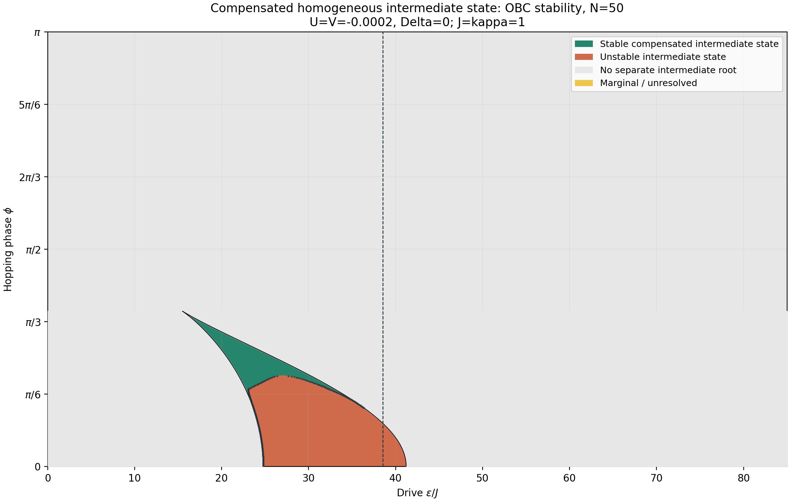

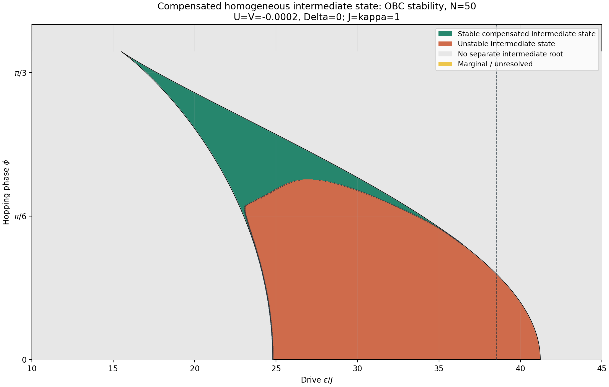

### Bulk root and the necessary change in compensation

Each nearest-neighbour cross-Kerr bond is counted once, H_cross=V sum_j n_j n_(j+1). The normally ordered mean-field onsite term retains the +U shift from U n_j^2. A uniform bulk root obeys

`epsilon^2=n[(Delta+U+2J cos(phi)+2(U+V)n)^2+(kappa/2)^2]`.

Here the nonlinear coefficient in this cubic is 2(U+V)=-0.0008; c(phi)=-0.0002+2 cos(phi). The middle of three positive density roots defines the intermediate solution. Its complex alpha0 is -epsilon/[c(phi)+2(U+V)n-i kappa/2].

An open end lacks both a hopping contribution and one cross-Kerr mean-field contribution. Keeping **Delta=0 at every site**, the required fixed additive endpoint pumps are

`pump_1=epsilon+[J exp(+i phi)+V n] alpha0`,

`pump_N=epsilon+[J exp(-i phi)+V n] alpha0`.

All other pumps remain epsilon. Omitting the V n alpha0 term would fail to make the state homogeneous and stationary. We compensate through fixed coherent drives, following the earlier protocol; no endpoint detuning or feedback is introduced. This prescription is root-specific, not optimized.

### The cross-Kerr BdG operator is not an onsite-Kerr substitution

For a uniform alpha0 and open-chain adjacency C, let z_j=sum_k C_jk (1 at each end, 2 in the interior). The exact linearization is

`A_jk=T_jk+delta_jk[Delta+U+4Un+z_j Vn-i kappa/2]+Vn C_jk`,

`B_jk=2U alpha0^2 delta_jk+V alpha0^2 C_jk`,

`L=[[A,B],[-B*,-A*]]`.

Thus cross-Kerr coupling produces both normal and anomalous intersite terms. In addition, the onsite coefficient at an end differs from the bulk by -Vn because that site has only one neighbour. **Fixed pump compensation cancels the stationary mismatch but does not restore missing fluctuation couplings or their onsite derivatives.** This map uses those actual degree-one edge coefficients. Replacing U by U+V in the earlier onsite-only BdG matrix, or silently using degree two at the ends, would describe a different operator and give a different map. Compensating through endpoint detunings would also be a different boundary prescription.

Modes evolve as exp(-i omega t); max Im(omega)<0 gives local stability. A global Nambu rotation makes the common pairing phase convenient without changing any eigenvalue. Because the compensation is fixed and additive, it contributes no BdG derivatives.

### Existence region, resolution and checks

Positive-density bistability requires c(phi)>sqrt(3) kappa/2, restricting the intermediate-root lobe to phi<64.334737 degrees. The cusp drive is epsilon=15.51008099; at phi=0 the root-existence endpoints are epsilon=24.79600570 and 41.22432756. Existence curves exclude the merger points as distinct intermediate roots. The full plot uses the earlier 0-85 drive scale for comparison, while the zoom covers 10-45.

The curved sampling has 320 phase rows and 91 intermediate-density fractions, clustered near both root mergers: 29120 spectra, of which 16494 are stable, 12626 unstable and 0 marginal. These counts are not geometric areas. Growth-rate zeros along each row are refined; the shading interpolates the spectra with those zero-growth points and masks outside the analytic existence lobe. The dashed vertical line marks epsilon=38.51 for comparison with earlier results. Near fine boundaries the plot is a finite-resolution numerical characterization.

The independent matrix construction is checked against the reusable cross-Kerr mean-field implementation, and its analytic Jacobian against finite differences. Representative phases 0,15,30,45,60 degrees at three density fractions are checked with the actual compensated complex stationary force (all below 1e-8). At those points independent real-quadrature characteristic-polynomial/Routh counts at 100 and 160 digits agree with the double-precision stable/unstable labels. These counts include onsite degree-one edge terms and both intersite pairing and normal coupling. Selected precision checks are not rigorous certificates for every plotted point.

Green regions establish locally stable compensated mean-field states only, not successful preparation from vacuum or robustness to compensation errors. The earlier V=0 maps remain in the report for comparison, but both Delta and V have changed here, so differences cannot be attributed to V alone. No Gaussian covariance evolution or fluctuation feedback enters this calculation.

Reproduce with `python src/cross_kerr_compensated_map.py`. Grid arrays, densities, drives, phases and growth rates are stored in data/generated/compensation_n50_u_equal_v_delta0/compensated_stability_map.npz. The companion JSON records parameters, refined zero-growth curves, endpoint pumps, stationary residuals and 100/160-digit checks. Full and zoom PNG/PDF figures use prefix compensated_stability_map_u_equal_v_delta0 under figures/.

## Equal U=V and Delta=0 with kappa=4: no intermediate target at any drive

Keep N=50, J=1, U=V=-0.0002 and Delta=0, and increase kappa from 1 to **4**. The intermediate-root compensation-stability map is now empty: **there is no separate intermediate homogeneous bulk root at any epsilon>=0 or 0<=phi<=pi**. Enlarging the drive scan cannot restore that target. This is absence of the branch, not an unstable BdG eigenmode, a failed preparation, or a failed numerical stationary solver.

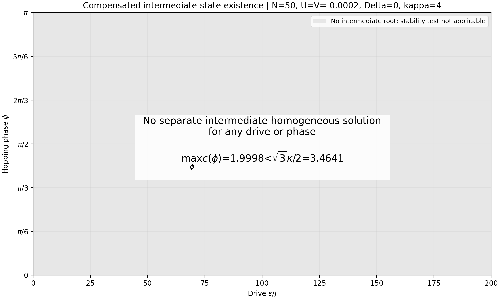

### Analytical check of the entire parameter space

With the same U n^2 and bond-counting conventions as above, define c(phi)=Delta+U+2J cos(phi)=-0.0002+2 cos(phi), beta=2(U+V)=-0.0008 and gamma=kappa/2=2. The cubic input-output relation is

`epsilon^2 = F(n) = n[(c+beta n)^2+gamma^2]`.

Three positive roots require c>sqrt(3)gamma. But max_phi c=1.9998, while sqrt(3)gamma=3.4641016151; the necessary condition fails at every phase. Equivalently,

`F'(n)=3(beta n+2c/3)^2+gamma^2-c^2/3`.

Since c ranges from -2.0002 to 1.9998, F'(n)>=2.6663999867>0 for all real n and all scanned phases. With F(0)=0 and F(n)->infinity as n->infinity, **exactly one nonnegative physical density root exists for every nonnegative drive**. At zero drive it is vacuum. Thus this conclusion is global in epsilon, not limited by the horizontal range shown in the plot.

The maximum loss rate for which a positive-density three-root region could exist with these fixed J, Delta and U is kappa_crit=2(Delta+U+2J)/sqrt(3)=2.3091701367. Kappa=4 exceeds it. V sets the nonlinear density/drive scales through beta, but increasing epsilon cannot overcome this detuning-versus-loss obstruction. Changing detuning or hopping would be a different parameter set and was not done.

### Numerical check over an enlarged drive range

As an independent numerical check, evaluate all roots of the cubic at 181 phases from 0 to pi, and 601 drives: 0-200 on a linear grid of spacing 0.5, plus a logarithmic tail to **epsilon=1,000,000**. Across 108781 checks, the physical nonnegative-root count is always one; no intermediate target is found. The maximum relative cubic residual of the retained root is 1.21e-14. The plot displays 0-200 rather than the previous 0-85, and the analytic monotonicity argument covers drives beyond both the display and numerical check range.

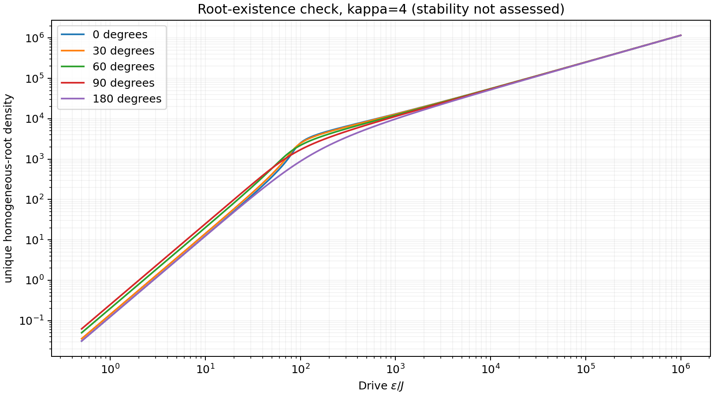

These curves show the remaining single homogeneous root. Its root-specific endpoint compensation could be constructed using the cross-Kerr formula derived above, but **its BdG stability is not assessed in this intermediate-phase calculation**. No claim is made that all inhomogeneous mean-field solutions are absent, or that all compensated states are unstable. Only the distinct intermediate homogeneous branch is ruled out. Accordingly, no intermediate-state BdG spectra, adiabatic ramps, or covariance equations are calculated here.

### Reproduction and records

Run `python src/cross_kerr_kappa4_existence.py`. Parameters, analytic bounds and root-check statistics are in data/generated/compensation_n50_u_equal_v_delta0_kappa4/bulk_root_check.json. The NPZ companion stores the full phase/drive grids, physical root counts and unique-root densities. New figures use prefix compensated_stability_map_u_equal_v_delta0_kappa4; the kappa=1 maps above are retained for comparison.

## Compensation sensitivity versus chain length: V=0, N=10..100

Return to **Delta=0.5, kappa=J=1, U=-0.0002, V=0**, with phi=pi/3 and epsilon=38.51. These are the original onsite-only baseline parameters, not the subsequent Delta=0/kappa=4 case. The intermediate density is n0=1990.520824757; the nominal compensations hL=J exp(+i phi) alpha0 and hR=J exp(-i phi) alpha0 have magnitude 44.615253 and are **independent of N**.

What scales exponentially is the stationary response to an error in those additions. For common fractional amplitude error eta, pump_1=epsilon+(1+eta)hL and pump_N=epsilon+(1+eta)hR, define S_common=max_j|d alpha_j/d eta|/|alpha0|. Calculating every integer N=10..100 gives

**S_common(N) approximately 1.305994 exp(0.167987171 N)** for N=50..100, with R^2=0.999998802.

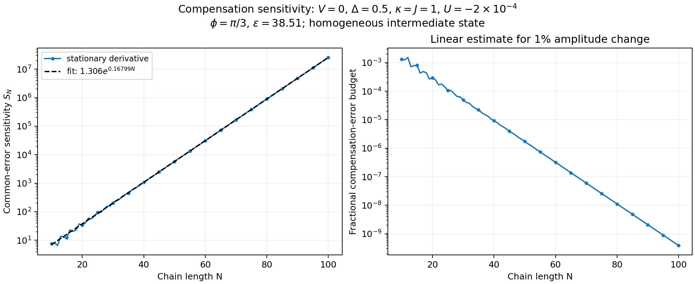

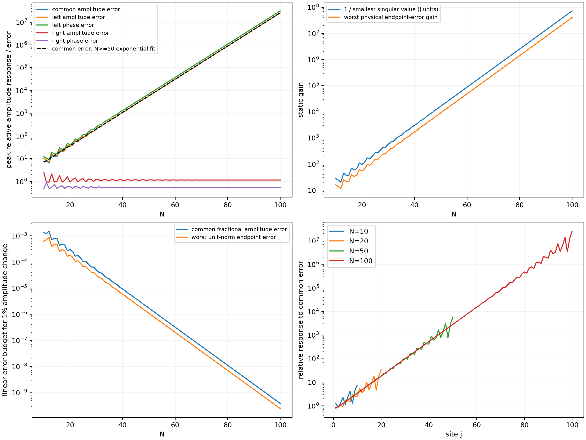

### Meaning of the error tolerance

To keep the peak complex-amplitude change at 1%, the linear estimate is |eta| approximately 0.01/S_common. This is a fractional error of the **compensation addition**, not of the total endpoint pump or density. It is a small-signal estimate, not a hard nonlinear failure threshold.

|N|S_common|linear common fractional error for 1% amplitude change|OBC growth / J|
|---:|---:|---:|---:|
|10|7.63402|0.00130993|-0.102504|
|20|33.771|0.000296112|-0.073533|
|30|203.661|4.91013e-05|-0.063741|
|40|1082.61|9.23695e-06|-0.059914|
|50|5780.41|1.72998e-06|-0.057127|
|60|31223.7|3.20269e-07|-0.055166|
|70|166804|5.99505e-08|-0.053971|
|80|896852|1.11501e-08|-0.052856|
|90|4.80663e+06|2.08046e-09|-0.052156|
|100|2.57976e+07|3.87633e-10|-0.051460|

The N=50 budget is about 1.7300 ppm; N=100 is about 0.3876 ppb. For the chosen orientation the growing sensitivity is primarily to **left-end** amplitude and phase errors. The right-end error responses remain order one. Independent phase-error parameters are in radians; the worst gain uses unit Euclidean norm of (etaL,thetaL,etaR,thetaR), and therefore has a different normalization from the common two-end amplitude protocol.

### Origin of the exponent

Differentiating the stationary equations gives L z'=-(q,-q*), so the response is a physical endpoint projection of the zero-frequency inverse BdG operator. Its smallest singular value decreases exponentially even though every tested OBC eigenmode decays (largest growth -0.051460 J).

The zero-frequency spatial roots beta of the bulk BdG recurrence are approximately 0.50403406, 1.18292077 and -0.73018179 +/- 1.06959480i. The three outside-unit-circle modes combine into a right-localized quasi-zero singular vector. Its longest tail is set by beta_star=1.18292077, giving

**mu=log|beta_star|=0.167986609 per site, xi=1/mu=5.952855 sites**.

Its boundary residual scales as exp(-mu N); endpoint inputs overlapping the corresponding left singular vector therefore have static gain exp(+mu N). The fitted physical response exponent 0.167987171 agrees with that independent spatial-root prediction. One decimal order of extra sensitivity is added approximately every 13.7070 sites. Oscillatory small-N corrections come from the faster-decaying complex spatial roots.

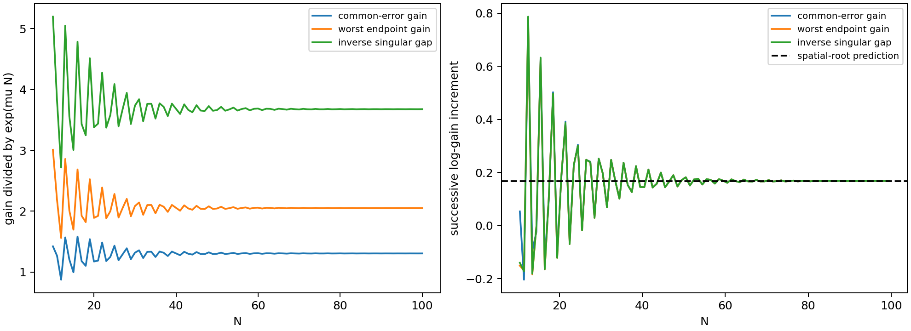

### Verification and interpretation

Independent 100/160-digit banded derivative solves at N=10,20,40,50,60,80,100 agree with double precision to maximum relative difference 1.15e-13 for the common gain. Nonlinear high-precision stationary checks at N=10,50,100, both signs of error and predicted relative amplitude changes 1e-5 and 1e-3, agree with linear response within 0.1566 percent. Force residuals are below 1e-55 in those nonlinear checks. The unperturbed compensated roots remain stable for all tested lengths.

The nominal compensation does not require an exponentially increasing field. Instead, the permitted **mismatch** shrinks exponentially if a fixed homogeneity tolerance is imposed on this amplified input channel. This is compatible with local dynamical stability and does not quantify global basins, time-dependent noise, or preparation success. Full input definitions, fit-window comparisons, spatial-root derivation, directional gains, and numerical checks are in [the analytical derivation](../derivations/compensation_sensitivity_scaling.md).

Reproduce with `python src/compensation_sensitivity_scaling.py`; helper src/compensation_precision.py implements the independent Decimal solves. Full records are data/generated/compensation_sensitivity/scaling.json. No covariance dynamics or fluctuation feedback is used.

## Preliminary independent Gaussian disorder tests of the compensated phase

These are new mean-field/BdG pilot calculations, with **two realizations per parameter setting**, not a disorder phase diagram. At epsilon=38.51, phi=pi/3, Delta=0.5, J=kappa=1, U=-0.0002 and V=0, the clean intermediate density is 1990.520825. We compare N=12, N=20 and N=50.

### Disorder and protocol

Disorder is static (quenched), real Gaussian and independent between sites/bonds. We test each parameter separately: Delta_j=0.5+sigma*z_j; J_j=1+sigma*z_j; or phi_j=pi/3+sigma*z_j, with z_j independent standard normals. Detuning sigma is in units of J, hopping sigma is also its fractional standard deviation since J=1, and phase sigma is in radians. The reverse hopping is the complex conjugate, preserving Hermiticity of the hopping Hamiltonian. We use sigma=1e-6, 1e-4, 1e-2 and seeds 20261104/20261105. Patterns are matched across strengths and chain lengths (short chains use prefixes); realizations are not independent across those comparisons.

The endpoint compensation remains fixed at its **clean** value, h_L=exp(i*phi)*alpha_0 and h_R=exp(-i*phi)*alpha_0. No disorder-dependent boundary tuning is applied. Starting from the already prepared clean compensated state, we switch on the full disorder and evolve for 1200/J. This tests a disorder quench, not vacuum preparation or a slow disorder ramp. In parallel, stationary continuation follows the clean branch as the disorder strength increases.

### Results

**All 54 quenches reached stationary states with negative BdG growth rates. Nevertheless, homogeneity is very sensitive, and the final attractor need not be the continuation of the clean compensated branch.** Here D_alpha=max_j|alpha_j-alpha_0|/|alpha_0|; ranges below span only the two realizations.

| N | Disorder | sigma | D_alpha range | Final max Im(omega)/J range |
|---:|:---|---:|---:|---:|
| 12 | delta | 1e-06 | 2.376e-06–2.539e-06 | -0.07203–-0.07202 |
| 12 | delta | 0.0001 | 0.0002377–0.0002537 | -0.07208–-0.07199 |
| 12 | delta | 0.01 | 0.02355–0.02426 | -0.07539–-0.06869 |
| 12 | J | 1e-06 | 2.275e-05–3.128e-05 | -0.07203–-0.07203 |
| 12 | J | 0.0001 | 0.002269–0.003123 | -0.07246–-0.07244 |
| 12 | J | 0.01 | 0.1871–0.2596 | -0.09049–-0.07470 |
| 12 | phi | 1e-06 | 7.701e-06–9.073e-06 | -0.07203–-0.07202 |
| 12 | phi | 0.0001 | 0.0007706–0.0009068 | -0.07217–-0.07197 |
| 12 | phi | 0.01 | 0.08173–0.08691 | -0.07915–-0.05939 |
| 20 | delta | 1e-06 | 2.058e-06–5.602e-06 | -0.07353–-0.07353 |
| 20 | delta | 0.0001 | 0.0002058–0.0005587 | -0.07356–-0.07353 |
| 20 | delta | 0.01 | 0.02086–0.04342 | -0.07653–-0.07304 |
| 20 | J | 1e-06 | 0.0001027–0.0001437 | -0.07354–-0.07354 |
| 20 | J | 0.0001 | 0.01004–0.01398 | -0.07421–-0.07409 |
| 20 | J | 0.01 | 0.3897–0.4652 | -0.09054–-0.08966 |
| 20 | phi | 1e-06 | 3.607e-05–3.937e-05 | -0.07354–-0.07353 |
| 20 | phi | 0.0001 | 0.003634–0.003908 | -0.07373–-0.07337 |
| 20 | phi | 0.01 | 0.2494–2.28 | -0.08766–-0.07363 |
| 50 | delta | 1e-06 | 0.0001194–0.0006647 | -0.05714–-0.05713 |
| 50 | delta | 0.0001 | 0.01169–0.06045 | -0.05869–-0.05743 |
| 50 | delta | 0.01 | 0.5333–1.858 | -0.10013–-0.04182 |
| 50 | J | 1e-06 | 0.01695–0.02322 | -0.05772–-0.05756 |
| 50 | J | 0.0001 | 0.4818–0.5077 | -0.08263–-0.07630 |
| 50 | J | 0.01 | 0.513–0.5176 | -0.13415–-0.13343 |
| 50 | phi | 1e-06 | 0.005856–0.007022 | -0.05730–-0.05698 |
| 50 | phi | 0.0001 | 0.3535–2.37 | -0.06563–-0.04644 |
| 50 | phi | 0.01 | 0.5139–2.501 | -0.13886–-0.05888 |

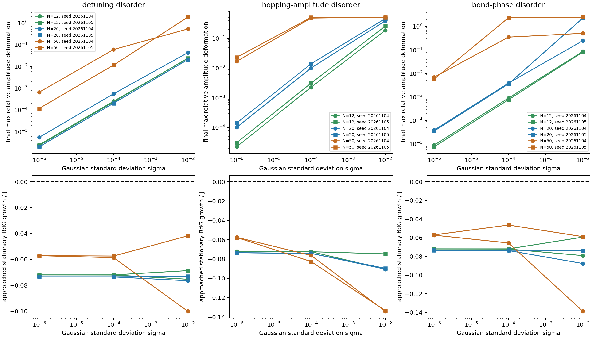

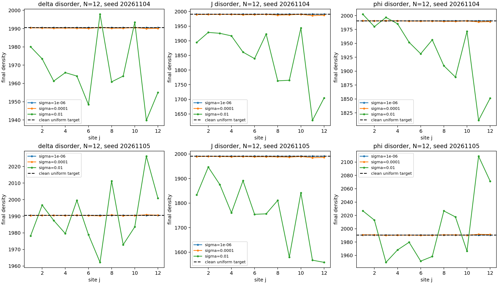

For N=12 all 18 quenches reach the same roots as stationary continuation (maximum complex-amplitude difference below 1.4e-12), and all sampled continuation points remain stable. At the largest tested sigma=0.01, maximum relative amplitude deformations are 2.36–2.43% for detuning, 18.7–26.0% for hopping, and 8.17–8.69% for phase disorder. Across all N=12 cases the growth rate lies between -0.09049 and -0.05939, compared with clean -0.07202. Thus these shorter chains show substantially weaker profile sensitivity and no observed branch switching in the pilot. These are two-realization comparisons, not statistical tolerance estimates.

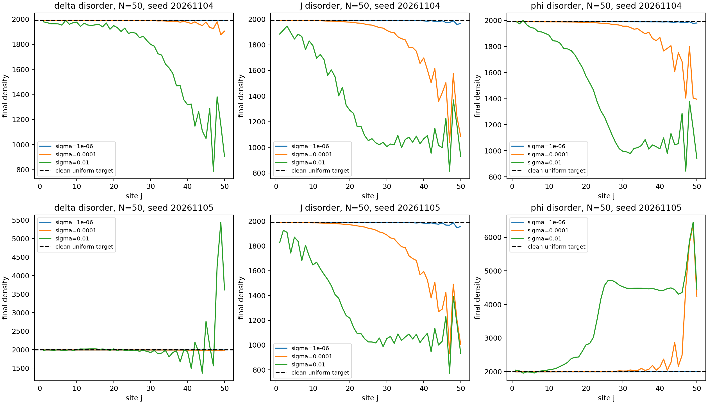

For example, N=50 hopping disorder at sigma=1e-6 produces 1.69–2.32% amplitude deformation; sigma=1e-4 produces 48.2–50.8%. The corresponding N=20 response is much smaller. This is consistent with the previously established amplification of static perturbations. A deviation above one in the table includes complex-phase changes and should not be read as a density percentage; the density profiles show the actual redistribution.

Stationary continuation reached full disorder in 51/54 cases; every accepted sampled point on these paths had negative growth. It stopped in the following three cases. These numerical stops do **not** establish branch nonexistence or an instability boundary:

| N | Disorder | Seed | Target sigma | Last reached fraction of target |
|---:|:---|---:|---:|---:|
| 20 | phi | 20261105 | 0.01 | 0.446724 |
| 50 | phi | 20261105 | 0.0001 | 0.409071 |
| 50 | phi | 20261105 | 0.01 | 0.004083 |

There is also direct evidence of basin dependence: for N=50 detuning disorder, seed 20261105 and sigma=0.01, continuation reaches a stable root, but the sudden quench reaches a different stable root (maximum complex-amplitude separation about 86.1). Thus negative growth of the final state alone does not prove persistence of the original branch.

### Separating spectral stability from background deformation

As a diagnostic control, we additionally retune the coherent drive at **every site** by subtracting the disordered stationary residual evaluated at alpha_0. This makes the clean uniform background an exact stationary solution of each disordered model. These drives are then treated as fixed coherent fields, not feedback. This is an ideal local compensation control, not the endpoint-only method. All 54 such uniform controls are also BdG stable. For N=50 their growth rates lie between -0.05782 and -0.05662, compared with clean -0.05713. In these samples, disorder has a much larger effect through the self-consistent background response than through its direct effect on the BdG spectrum at the restored uniform background.

**Interpretation:** the pilot supports robustness of dynamical stability over these samples, while revealing strong fragility of the homogeneous profile with fixed endpoint fields. It does not establish that the final inhomogeneous attractors retain the clean topological phase. A disordered topological invariant/transition has not been computed; independent site-scale disorder does not justify a slowly varying local-bulk winding approximation. Singular values and singular-vector centers are saved as response diagnostics only.

### Numerical checks and reproducibility

Evolution uses DOP853, rtol=2e-10, atol=2e-11; the final state must have raw force below 1e-3 and lie within 1e-3 in maximum amplitude of a stationary root polished to residual below 1e-8. All final polished force residuals are below 1.2e-13. Growth is max Im(omega) for i*dot(z)=L*z, cross-checked against the real-quadrature evolution generator. The sign classification uses a minimum 1e-7 resolution with additional leading-eigenvalue conditioning and basis-agreement checks. Three N=50, sigma=0.01 runs (one per disorder type, first seed) repeated to time 2400/J with 100-times tighter tolerances reproduce the final density to maximum absolute difference below 6e-11. Analytic Jacobians and disorder forcing derivatives were checked against finite differences.

Continuation uses adaptive parameter steps up to 0.2, stops below step 1e-5, and rejects stationary steps with maximum amplitude change above 2; its stopping point is algorithm dependent. Two realizations and three widely separated strengths cannot determine a disorder tolerance or rare-event probability. No covariance dynamics or fluctuation feedback is included.

Reproduce with `python src/preliminary_compensated_disorder.py`. The complete records, disorder vectors, continuation paths, spectra diagnostics, final profiles and sampled density trajectories are in `data/generated/compensated_disorder_pilot/pilot.json`.

## Zero-frequency singular response versus disorder and chain size

We evaluate the BdG operator L of each actual stationary attractor reached in the disorder quench, with i*dot(z)=L*z, using the same particle/hole basis and Euclidean norm as above. The spectral reference is omega=0. Define s0=min singular_value(L) and G0=1/s0=||L^(-1)||_2 (in 1/J). This is the maximum static linear-response gain over normalized particle/hole forcing vectors. It is a topological amplification diagnostic, **not a quantized topological invariant**. In particular, a large inverse singular value alone cannot establish topology.

The extended chiral matrix H_ext(0)=[[0,L],[L^dagger,0]] has eigenvalues +/-s_n. Small s0 therefore diagnoses near-zero modes of that Hermitian extension. We do not compute a disordered winding number here. The calculation uses the full inhomogeneous background; it does not assume a slowly varying local bulk.

The clean reference values are:

| N | s0/J | G0*J | s1/s0 |
|---:|---:|---:|---:|
| 12 | 0.04899984 | 20.40823 | 9.6266 |
| 20 | 0.01028249 | 97.25267 | 37.781 |
| 50 | 6.143082e-05 | 16278.48 | 5006.1 |

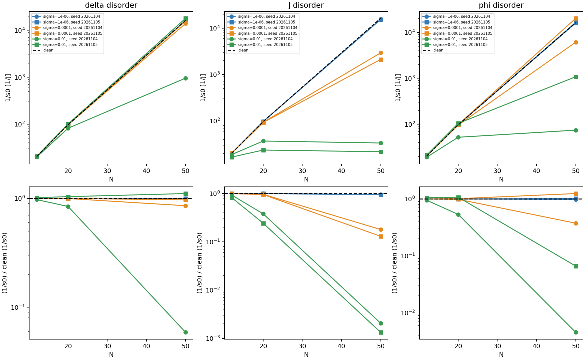

Ranges below span the two realizations, not confidence intervals. The compensation fields remain fixed at their clean endpoint values.

| Disorder | sigma | G0*J, N=12 | G0*J, N=20 | G0*J, N=50 |
|:---|---:|---:|---:|---:|
| delta | 1e-06 | 20.408–20.408 | 97.25–97.253 | 16250–16273 |
| delta | 0.0001 | 20.402–20.411 | 97.035–97.282 | 13957–15790 |
| delta | 0.01 | 19.911–20.754 | 82.019–100.99 | 958.21–18044 |
| J | 1e-06 | 20.408–20.408 | 97.204–97.216 | 15330–15578 |
| J | 0.0001 | 20.356–20.359 | 92.727–93.766 | 2121.6–2934.4 |
| J | 0.01 | 16.71–18.965 | 23.661–37.031 | 21.754–33.579 |
| phi | 1e-06 | 20.408–20.408 | 97.239–97.265 | 15983–16531 |
| phi | 0.0001 | 20.391–20.416 | 95.948–98.501 | 6119.1–20257 |
| phi | 0.01 | 19.328–21.536 | 52.174–104.65 | 74.467–1082.1 |

At weak disorder, the strong growth of G0 with N survives. With sigma=0.01 hopping disorder, G0 is only 16.7–37.0 across N=12,20 and 21.8–33.6 at N=50, compared with the much larger clean N=50 gain. Thus the stationary background deformation can cut off the clean size amplification. Phase and detuning disorder have stronger realization dependence, including branch changes identified above; their final-state gain must not be interpreted as following a single branch continuously. Three sizes and two realizations do not establish an asymptotic localization exponent or a disorder-driven topological boundary.

For comparison, the following uses the ideal **all-site** drive retuning control that restores alpha_0 exactly. It isolates the direct disorder effect on the uniform-background BdG operator, and is not the endpoint-only protocol.

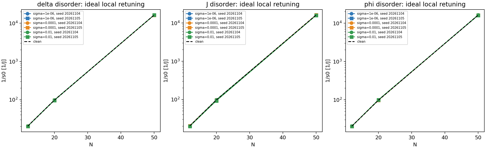

All SVDs use double-precision dense decomposition. The smallest value in the pilot remains well above the roundoff scale of L. No new time evolutions are needed: the stationary backgrounds and their SVD diagnostics are those of the validated disorder pilot. Reproduce with `python src/disorder_singular_response.py`; numerical values, singular gap ratios and left/right singular-vector centers are saved in `data/generated/compensated_disorder_pilot/singular_response.json`.

## Example: compensation creates an accessible topological bulk at epsilon=32

At N=50, J=kappa=1, U=-0.0002, V=0, Delta=0.5, phi=pi/3 and epsilon=32, the existing independent vacuum-preparation calculation gives the following comparison. Stability uses i*dot(z)=L*z and the spectral reference for winding/SVD is omega=0.

| Quantity | Uncompensated vacuum attractor | Compensated intermediate state |
|:---|---:|---:|
| Density at site 25 | 535.695 | 2988.597 |
| Density range, sites 10–40 | 468.119–616.593 | 2988.597 (uniform) |
| Frozen bulk winding at site 25 | 0 | -1 |
| max Im(omega)/J | -0.261254 | -0.102268 |
| 1/s0 in 1/J | 5.32683 | 37963.3 |
| Stationary max force/J | 1.39e-14 | 4.94e-14 |

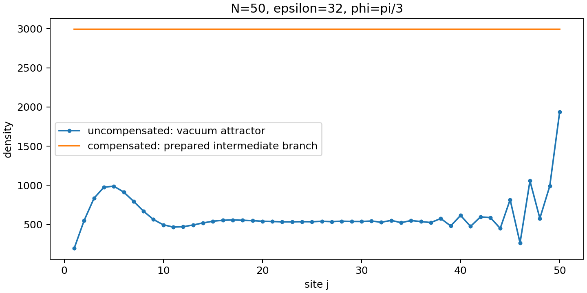

The compensated amplitude is alpha_0=-28.4253948133-46.6968340029i. The endpoint pump additions are h_L=26.2279471162-47.9655310224i and h_R=-54.6533419295+1.2686970194i; these are additions to the uniform drive epsilon=32. Its uniform bulk winding is -1, with a bulk singular point gap of 0.173666J. The uniform target is exactly stationary and OBC stable. The saved vacuum -> uncompensated relaxation -> smooth compensation ramp protocol reaches it for both T=1000/J and T=10000/J (maximum amplitude errors below 2e-9 after the final hold).

The uncompensated state has frozen winding zero at sites 1–49. Only the last site has a nonzero frozen label; parameters there vary sharply (maximum adjacent coefficient change 1.085J). An isolated boundary label does not establish a bulk topological segment. The smallest-singular-vector centers are near the same right edge (48.15 and 48.52), whereas those of the compensated target lie at opposite ends (48.46 and 2.54). Thus this is evidence of compensation converting an accessible **trivial-bulk** state into a homogeneous topological bulk, rather than a claim of a rigorously classified globally trivial inhomogeneous operator.

We have not excluded other uncompensated stationary branches and cannot assert that this parameter point admits only trivial solutions without compensation. Also, epsilon=38.51 is not an example of trivial uncompensated bulk: its uncompensated attractor already has an extended nonzero frozen-winding segment. The epsilon=32 example makes the narrower, directly tested preparation comparison explicit.

Source: `data/generated/compensation_n50/preparation_30_35/epsilon_32.000000.json`. Reproduce the comparison and 16384-point winding checks with `python src/compensation_trivial_bulk_example.py`; the underlying evolution protocol and tolerances are documented in the preparation scan above.
